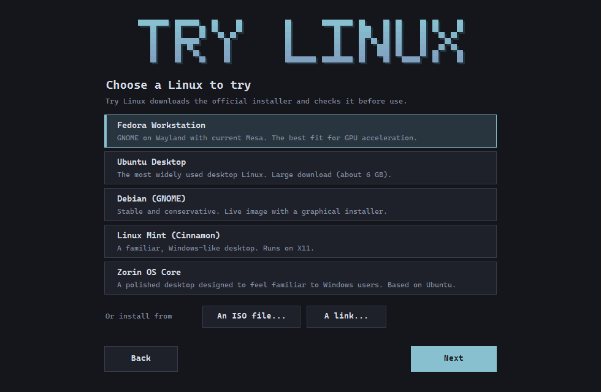
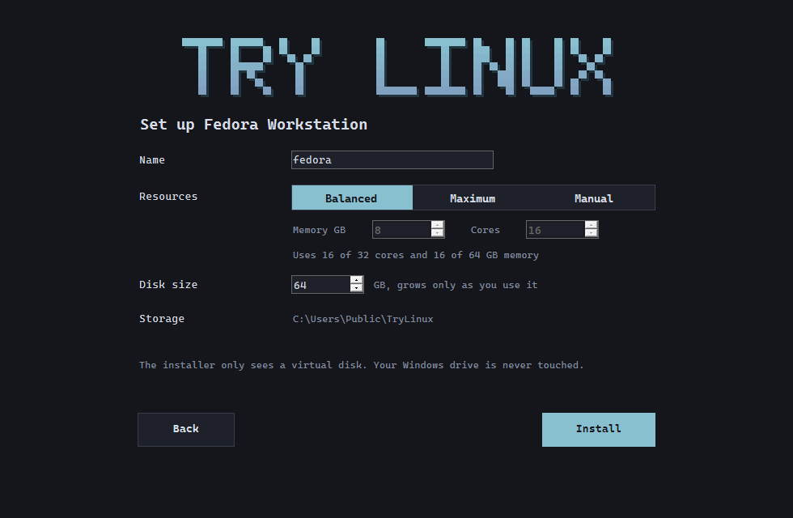
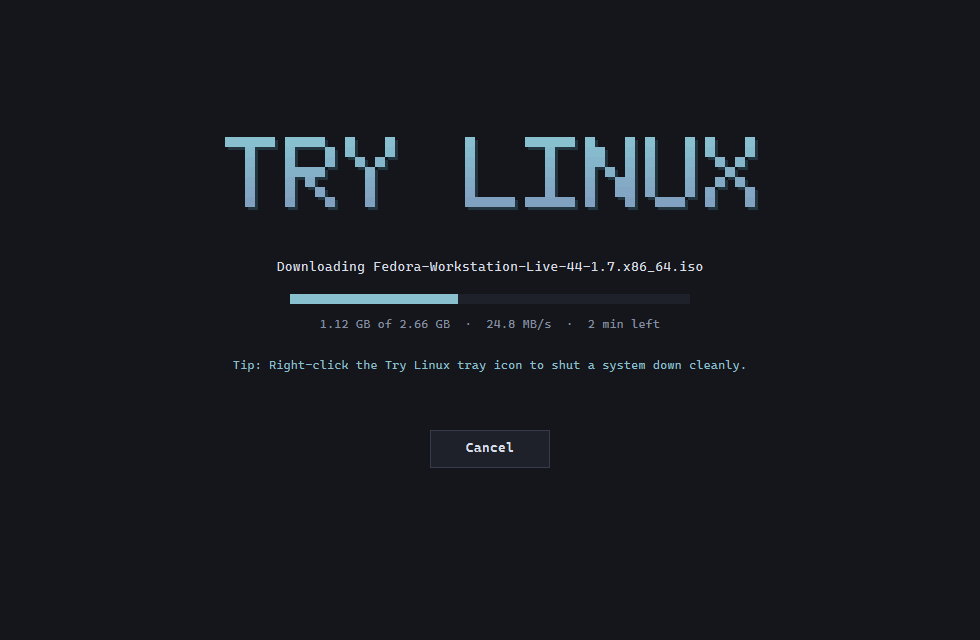
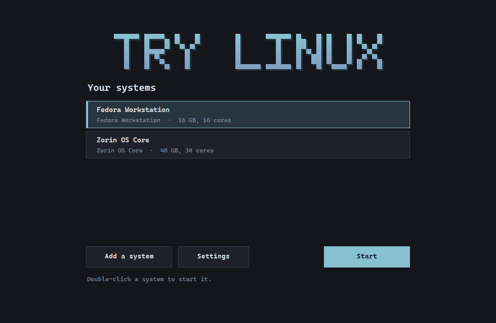
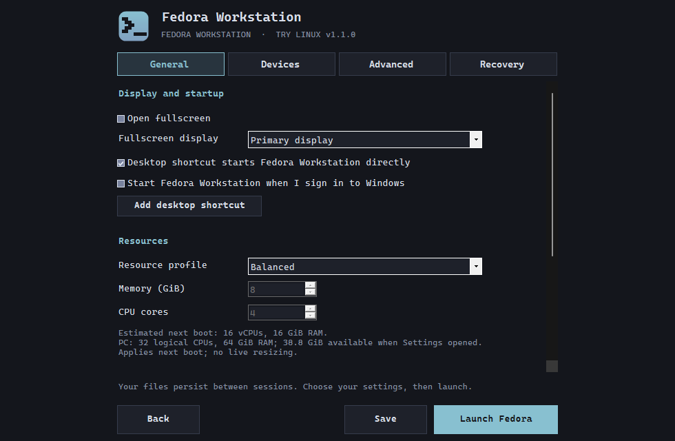
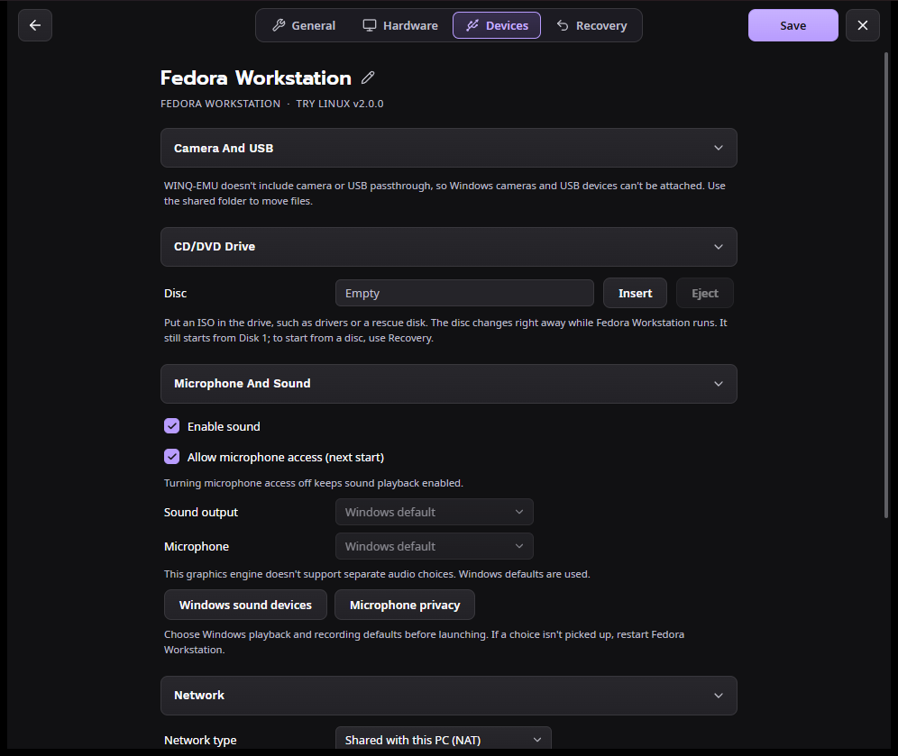
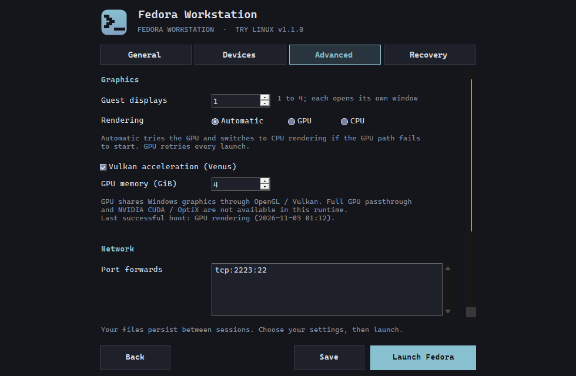
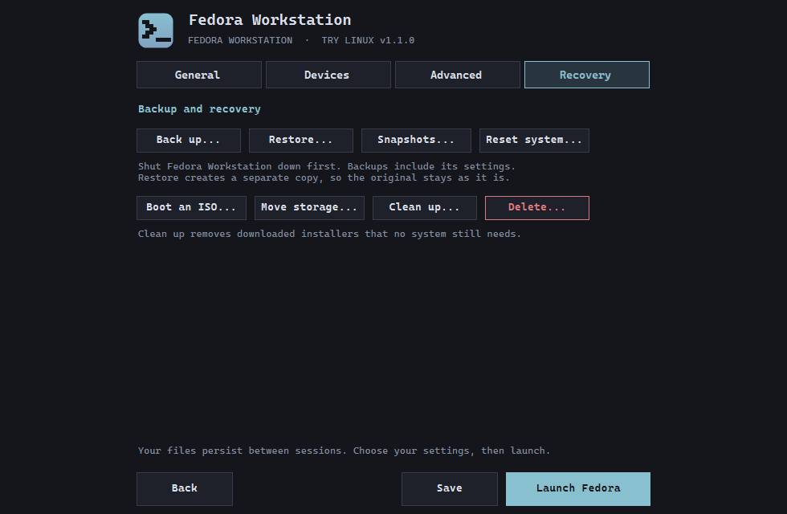
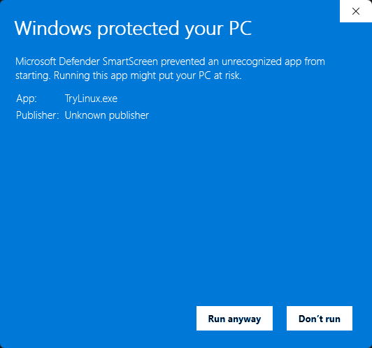

# Try Linux

Try a Linux desktop on Windows in a window, without repartitioning your drive.
Pick a distribution, and Try Linux downloads the official installer, checks it
against the distribution's published SHA-256 checksum, creates a virtual disk
and boots it with GPU acceleration.

Try Linux is a small launcher around [WINQ-EMU](https://github.com/cmspam/winq-emu),
a QEMU build for Windows that uses the Windows Hypervisor Platform and forwards
OpenGL / Vulkan graphics (VirGL and Venus) to the guest.



## Screenshots

| | |
|---|---|
|  |  |
| **Set up:** name, resource profile and disk size | **Download:** the official ISO, checked against its SHA-256 |
|  |  |
| **Your systems:** start, open settings or add another | **Settings, General:** display, startup, resources, storage |
|  |  |
| **Settings, Devices:** sound and microphone | **Settings, Advanced:** displays, rendering, port forwards |
|  | |
| **Settings, Recovery:** backups, snapshots, reset, storage | |

## Distributions

| Distribution | Notes |
|---|---|
| Fedora Workstation | GNOME on Wayland with current Mesa; the best fit for GPU acceleration |
| Ubuntu Desktop | About 6 GB download |
| Debian (GNOME) | Live image with a graphical installer |
| Linux Mint (Cinnamon) | Windows-like desktop, X11 |
| Zorin OS Core | Windows-like desktop based on Ubuntu |

Try Linux finds the newest release on each distribution's official mirror when
you install, so it doesn't need updating for new versions. You can also install
from any `.iso` file on your PC or from a download link.

## Requirements

- 64-bit Windows 10 or 11 (ARM64 is not supported)
- Hardware virtualization turned on in your PC's BIOS/UEFI
- About 20 GB of free space per system
- Internet access for the first setup

On first setup Try Linux offers to:

1. **Install WINQ-EMU** (about 55 MB) from its GitHub releases. It isn't bundled.
2. **Turn on Windows Hypervisor Platform.** Windows asks for permission, then needs one restart.

## Install

1. Download `TryLinux-<version>.zip` from [Releases](../../releases) and extract it.
2. Run `TryLinux.exe`.

The app isn't code-signed, so Windows may show **"Windows protected your PC"**.
Click **More info**, then **Run anyway**:



You can check the download against the SHA-256 hash published with each release:

```powershell
Get-FileHash .\TryLinux.exe -Algorithm SHA256
```

## Using it

- **Choose a Linux**, then **Next** and **Install**. Setup downloads and verifies the
  installer, creates the disk and opens the VM window. Install Linux onto the
  virtual disk; your Windows drive is never touched.
- While a system runs, Try Linux sits in the tray. Right-click its icon to show the
  window, open the shared folder, shut down cleanly or force stop.
- **Settings** (per system):
  - **General:** fullscreen and which display, start at Windows sign-in, desktop
    shortcut, resource profile (Balanced / Maximum / Manual), disk capacity,
    shared Windows folder (read-only unless allowed).
  - **Devices:** sound and microphone.
  - **Advanced:** guest displays, GPU / CPU / automatic rendering, Vulkan, GPU
    memory, port forwards (`tcp:2223:22` for this PC, `lan tcp:8080:80` for your
    network).
  - **Recovery:** back up, restore as a copy, snapshots, reset, boot an ISO, move
    storage, clean up downloads, delete.

Keyboard: **Ctrl+Alt+G** releases the mouse and keyboard, **Ctrl+Alt+F** toggles
fullscreen.

To use the shared folder in Linux:

```sh
sudo mkdir -p /mnt/host
sudo mount -t 9p -o trans=virtio,version=9p2000.L host /mnt/host
```

Systems, downloads and settings live in `%LOCALAPPDATA%\TryLinux` (movable from
Settings > Recovery).

## Limitations

- No camera or USB passthrough, and no choice of sound device (Windows defaults
  are used). WINQ-EMU doesn't support these.
- No clipboard sharing or drag-and-drop between Windows and Linux.
- Chromium-based browsers can show black video in the guest; Firefox works best.
- WINQ-EMU is alpha software.

## Building from source

Try Linux uses the C# compiler that ships with Windows, so nothing needs installing:

```bat
build.cmd
```

This produces `TryLinux.exe` from `TryLinux.cs` and `Settings.cs`.

`try-linux-vm.ps1` is a standalone PowerShell script that does the same VM setup
from the command line.

## Credits and licence

- [WINQ-EMU](https://github.com/cmspam/winq-emu) by cmspam: QEMU (GPL-2.0),
  virglrenderer (MIT), launcher (MIT). Downloaded by Try Linux, not redistributed.
- Inspired by [Try Omarchy for Windows](https://github.com/omacom/try-omarchy-windows).
- Linux distributions are downloaded from their official mirrors and carry their own licences.

Try Linux is released under the [MIT License](LICENSE).
