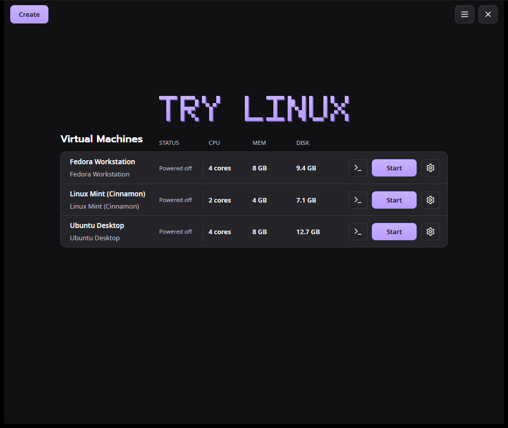

# Try Linux

Try a Linux desktop without repartitioning your drive. Pick a distribution, and Try Linux
downloads the official installer, checks it against the distribution's published SHA-256 or
SHA-512 checksum, creates a virtual disk and boots it in a window.



## Editions

| Edition | Runs on | Virtual machines | Download |
|---|---|---|---|
| [**Try&nbsp;Linux&nbsp;for&nbsp;Windows**](prototype/README.md) | Windows&nbsp;10,&nbsp;11 | QEMU,&nbsp;Hyper-V&nbsp;platform | [Latest](https://github.com/donnysaengkio/try-linux/releases/latest) |
| [**Try&nbsp;Linux&nbsp;for&nbsp;Mac**](macos/README.md)&nbsp;(preview) | Apple&nbsp;silicon | Apple&nbsp;Virtualization | [`macos-v`&nbsp;releases](https://github.com/donnysaengkio/try-linux/releases?q=macos-v&expanded=true) |
| [**Try&nbsp;Linux&nbsp;for&nbsp;Linux**](prototype/README-linux.md) | x86_64,&nbsp;ARM64 | QEMU&nbsp;with&nbsp;KVM | [`linux-v`&nbsp;releases](https://github.com/donnysaengkio/try-linux/releases?q=linux-v&expanded=true) |

The Windows edition runs QEMU through [WINQ-EMU](https://github.com/cmspam/winq-emu), with
OpenGL and Vulkan graphics; the Linux edition needs GTK 4 and libadwaita, and uses VirGL for 3D.

Try Linux 2.x for Windows and Linux (in `prototype/`) replaces Windows 1.x (in `windows/`) and Linux 1.0.x (in
`linux/`), which update to it on its own.

Each edition updates itself from its own releases here: Windows releases are tagged `v1.2.3`,
Mac releases `macos-v1.2.3-preview` and Linux releases `linux-v1.2.3-preview`.

## The distribution catalog

The editions share two lists, each entry with its official mirror, how to find the newest
installer there and its checksum file:

- [`catalog/distros.json`](catalog/distros.json): x86_64 installers (Windows, and Linux on
  x86_64 PCs), and over 400 distributions from DistroWatch that you download from their
  website (every edition).
- [`catalog/distros-aarch64.json`](catalog/distros-aarch64.json): ARM64 installers (the Mac,
  and Linux on ARM64 PCs).

The apps check them when you open Choose a Linux OS, so new entries appear without a new
release. Their addresses are part of the released apps, so they stay in `catalog/` on
`main`.

## Repository layout

```
catalog/   the shared distribution list
prototype/ Try Linux for Windows 2.x (Tauri: Rust and React), on its way to macOS and Linux too
windows/   Try Linux for Windows 1.x (C# WinForms), replaced by 2.x
macos/     Try Linux for Mac (SwiftUI, built with scripts/build-app.sh)
linux/     Try Linux 1.0.x for Linux (Python, GTK 4 and libadwaita), replaced by 2.x
```

Each edition has its own CI workflow, run when its folder (or the catalog) changes. The Mac
and Linux editions were separate repositories (try-linux-macos and try-linux-linux) until
November 2026; their full history is here, under `macos/` and `linux/`.

## License

MIT. See [LICENSE](LICENSE).
