# Try Linux

Try a Linux desktop on Windows without repartitioning your drive.
Pick a distribution, and Try Linux downloads the official installer, checks it
against the distribution's published SHA-256 checksum, creates a virtual disk
and boots it with GPU acceleration.

Try Linux is a small launcher around [WINQ-EMU](https://github.com/cmspam/winq-emu),
a QEMU build for Windows that uses the Windows Hypervisor Platform and forwards
OpenGL / Vulkan graphics (VirGL and Venus) to the guest.


## Screenshots

| | |
|---|---|
| 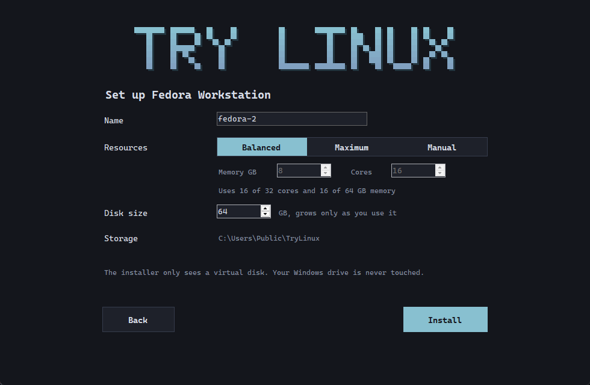 | 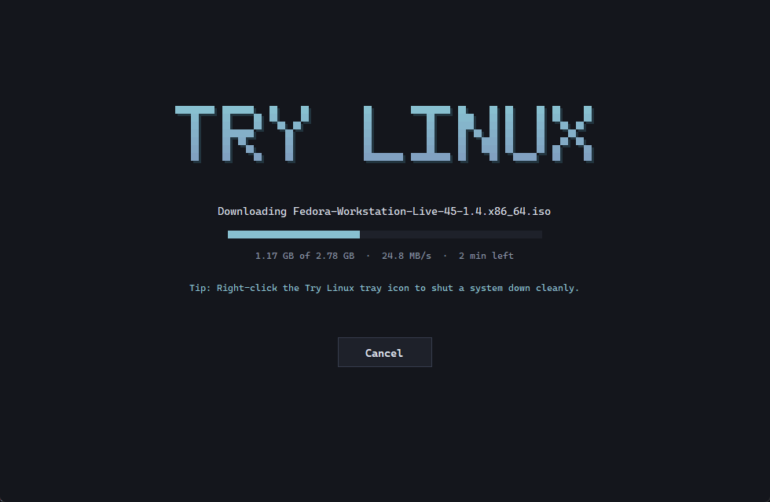 |
| **Set up:** name, resource profile and disk size | **Download:** the official ISO, checked against its SHA-256 |
| 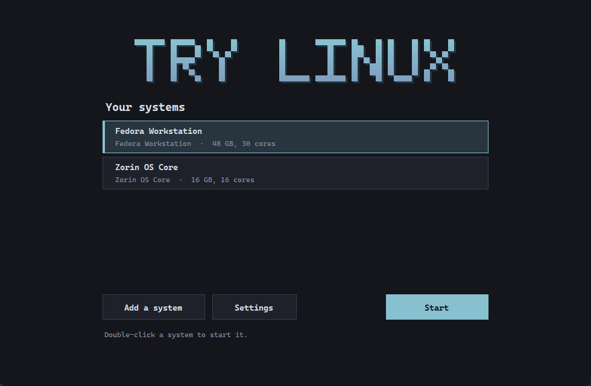 | 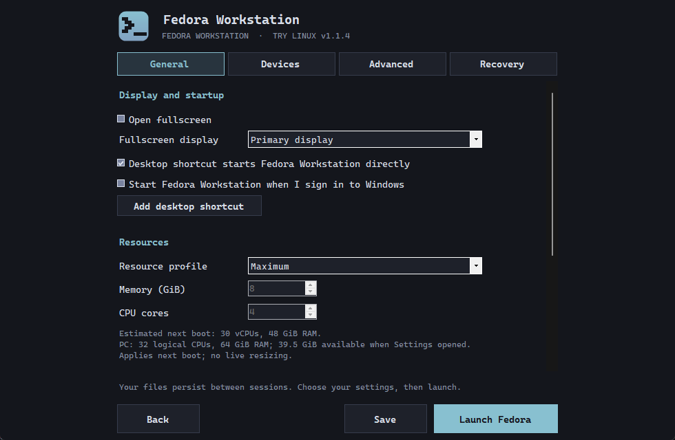 |
| **Your systems:** start, open settings or add another | **Settings, General:** display, startup, resources, storage |
| 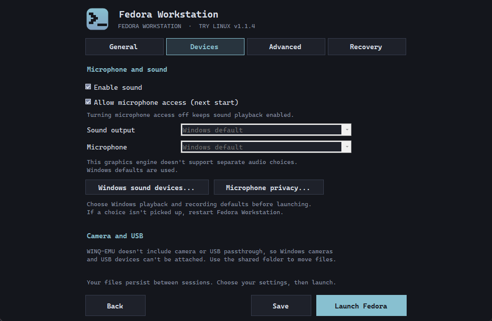 | 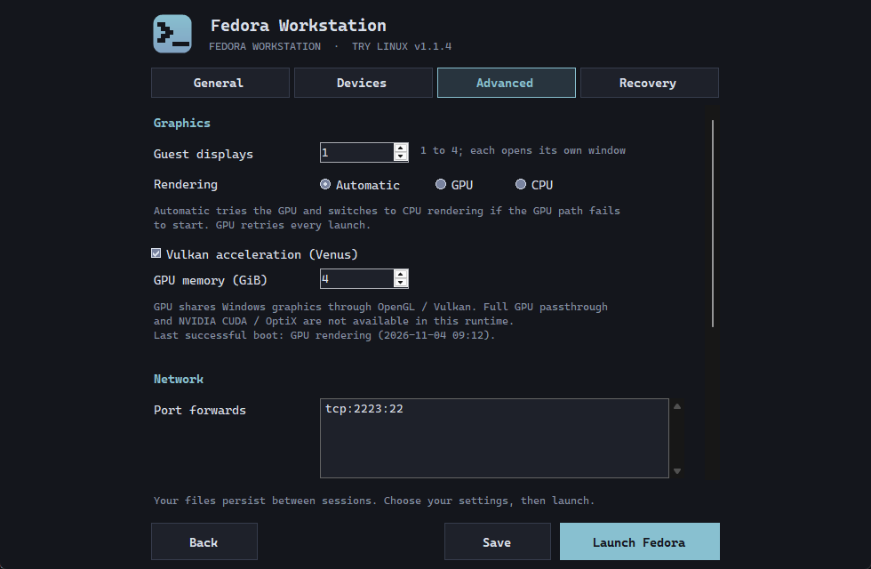 |
| **Settings, Devices:** sound and microphone | **Settings, Advanced:** displays, rendering, port forwards, updates |
| 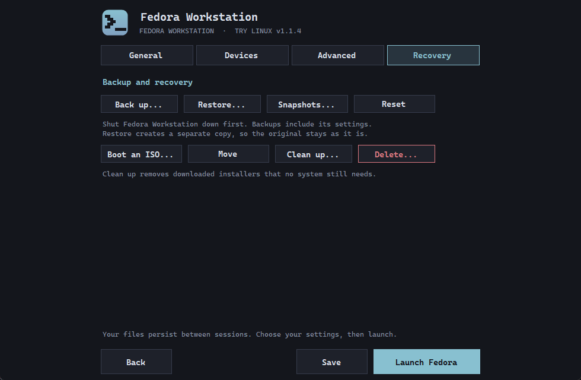 | |
| **Settings, Recovery:** backups, snapshots, reset, storage | |

## Distributions

| Distribution | About |
|---|---|
| [Fedora&nbsp;Workstation](https://fedoraproject.org/workstation/) | A community distribution sponsored by Red Hat that ships new GNOME, kernel and Mesa releases soon after they come out |
| [Ubuntu&nbsp;Desktop](https://ubuntu.com/desktop) | The most widely used desktop Linux, made by Canonical, with long-term support releases and a large software catalog |
| [Debian](https://www.debian.org/) | One of the oldest community distributions, known for stability and the base of Ubuntu, Mint and many others |
| [Linux&nbsp;Mint](https://linuxmint.com/) | A beginner-friendly distribution based on Ubuntu, with the Windows-like Cinnamon desktop and media codecs available at install |
| [Zorin&nbsp;OS](https://zorin.com/os/) | A polished distribution based on Ubuntu, designed to feel familiar to people moving from Windows |

Try Linux finds the newest release on each distribution's official mirror when
you install, so it doesn't need updating for new versions. You can also install
from any `.iso` file on your PC or from a download link.

## Requirements

- 64-bit Windows 10 or 11 (ARM64 is not supported)
- Hardware virtualization turned on in your PC's BIOS/UEFI
- About 20 GB of free space per system
- Internet access for the first setup

On first setup Try Linux offers to:

1. **Install WINQ-EMU** (about 55 MB) from its GitHub releases. It isn't bundled.
2. **Turn on Windows Hypervisor Platform.** Windows asks for permission, then needs one restart.

## Install

1. Download `TryLinux-<version>.zip` from [Releases](../../releases) and extract it.
2. Run `TryLinux.exe`. The app isn't code-signed, so Windows may show
   **"Windows protected your PC"**. Click **More info**, then **Run anyway**:

   

3. Try Linux asks whether to install itself:

   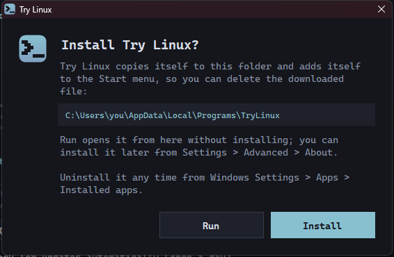

   - **Install** copies Try Linux to `%LOCALAPPDATA%\Programs\TryLinux` and adds it to
     the Start menu, so you can delete the download. **Try Linux is installed**
     confirms it; click **Open** to start the installed copy. No administrator
     permission is needed.
   - **Run** opens it from where it is, without installing. It won't ask again for
     this version; you can install later from **Settings > Advanced > About**.
   - Closing the window asks whether to quit, and Try Linux asks again next time.

If a different version is already installed, the same prompt offers **Update**
instead, which replaces the installed copy. Desktop shortcuts and Start with Windows
entries made by another copy move to the installed one.

You can check the download against the SHA-256 hash published with each release:

```powershell
Get-FileHash .\TryLinux.exe -Algorithm SHA256
```

### Uninstall

Use **Windows Settings > Apps > Installed apps > Try Linux > Uninstall**. Quit Try
Linux from its tray icon first. This removes the app, its Start menu entry, desktop
shortcuts and Start with Windows entries. Your systems and downloads are kept in
`%LOCALAPPDATA%\TryLinux`; delete that folder to remove them too.

If you chose **Run** instead of installing, delete `TryLinux.exe` and any desktop
shortcuts you made for it.

## Updates

Once a day, Try Linux checks GitHub for a new release of Try Linux and of
[WINQ-EMU](https://github.com/cmspam/winq-emu), the emulator that runs your systems.
When one is available, a button appears on the home screen: **Update to x.y.z**,
**Update WINQ-EMU**, or **Updates available** when there are both.

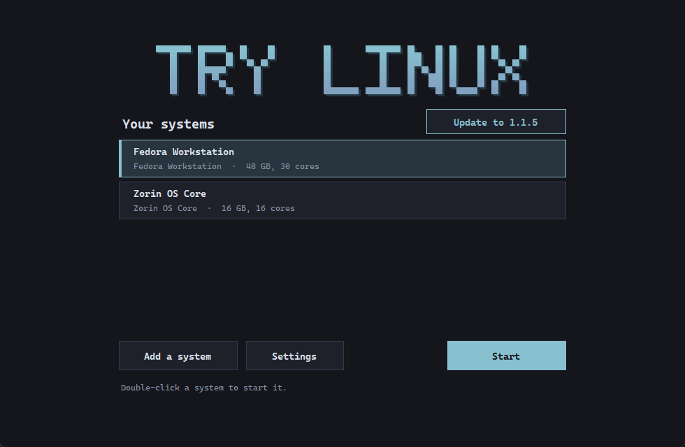

**Try Linux updates**

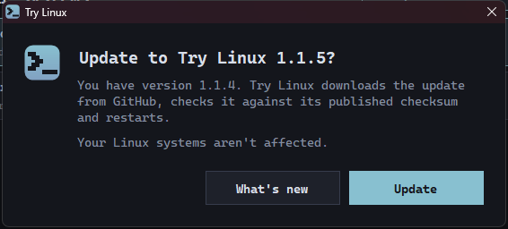

1. **What's new** opens the release notes; **Update** downloads the new `TryLinux.exe`.
2. Try Linux checks the download against the release's published SHA-256 checksum.
   If it doesn't match, the update isn't used.
3. Try Linux replaces itself and restarts. If systems are running, choose **Restart
   now** or **Update when I quit**; your systems keep running either way.

Copies that aren't installed update themselves in place. Versions before 1.1.4 don't
have the Update button, so download 1.1.4 once by hand.

**WINQ-EMU updates**

1. **Update WINQ-EMU** shows your version and the new one. WINQ-EMU is an alpha, so
   check **What's new** before updating.
2. Shut down running systems first; WINQ-EMU's files are in use while they run.
3. Try Linux downloads the new installer from the WINQ-EMU releases page and runs it.
   Windows asks for permission, because it installs to `C:\WINQ-EMU`.

**Settings > Advanced > About** shows both versions, has **Check for updates** to
check right away, and **Check for updates automatically (once a day)** to turn the
daily check off.

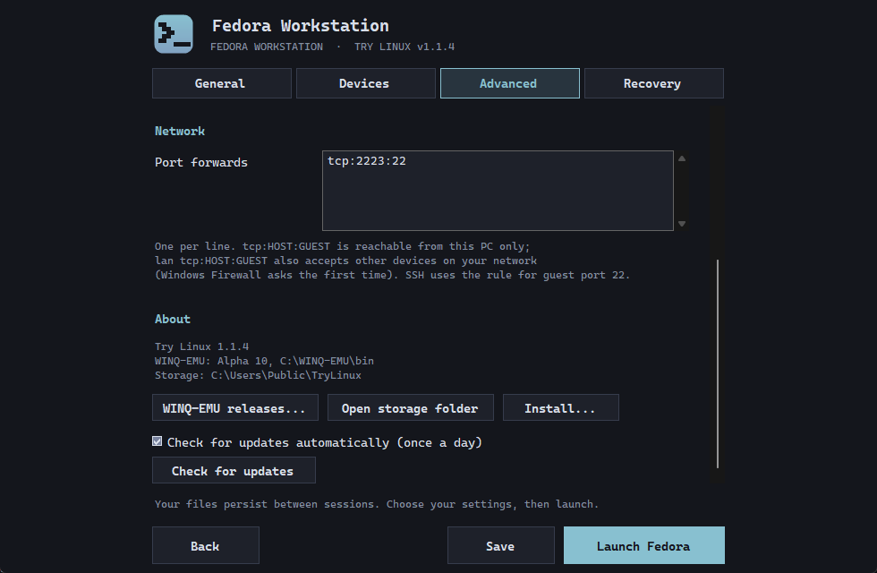

## Using it

- **Choose a Linux OS**, then **Next** and **Install**. Setup downloads and verifies the
  installer, creates the disk and opens the VM window. Install Linux onto the
  virtual disk; your Windows drive is never touched.
- While a system runs, Try Linux sits in the tray. Right-click its icon to show the
  window, open the shared folder, shut down cleanly or force stop.
- **Settings** (per system):
  - **General:** fullscreen and which display, start at Windows sign-in, desktop
    shortcut, resource profile (Balanced / Maximum / Manual), disk capacity,
    shared Windows folder (read-only unless allowed).
  - **Devices:** sound and microphone.
  - **Advanced:** guest displays, GPU / CPU / automatic rendering, Vulkan, GPU
    memory, port forwards (`tcp:2223:22` for this PC, `lan tcp:8080:80` for your
    network), and **About** with versions, install and update checks.
  - **Recovery:** back up, restore as a copy, snapshots, reset, boot an ISO, move
    storage, clean up downloads, delete.

Keyboard: **Ctrl+Alt+G** releases the mouse and keyboard, **Ctrl+Alt+F** toggles
fullscreen.

To use the shared folder in Linux:

```sh
sudo mkdir -p /mnt/host
sudo mount -t 9p -o trans=virtio,version=9p2000.L host /mnt/host
```

Systems, downloads and settings live in `%LOCALAPPDATA%\TryLinux` (movable from
Settings > Recovery).

## Troubleshooting

**Check first:** open Task Manager (Ctrl+Shift+Esc), go to **Performance > CPU**, and
look for **Virtualization**. It should say **Enabled**.


**"Hardware virtualization is turned off in your PC's BIOS/UEFI settings"**
Linux needs the processor's virtualization feature, which some PCs ship with turned off.
Try Linux shows this message:

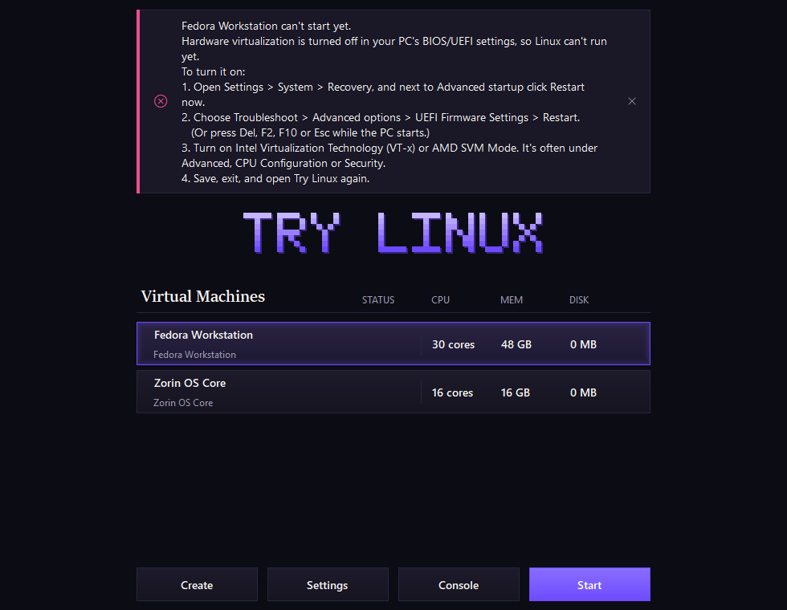

1. Open **Settings > System > Recovery**, and next to **Advanced startup** click **Restart now**.

   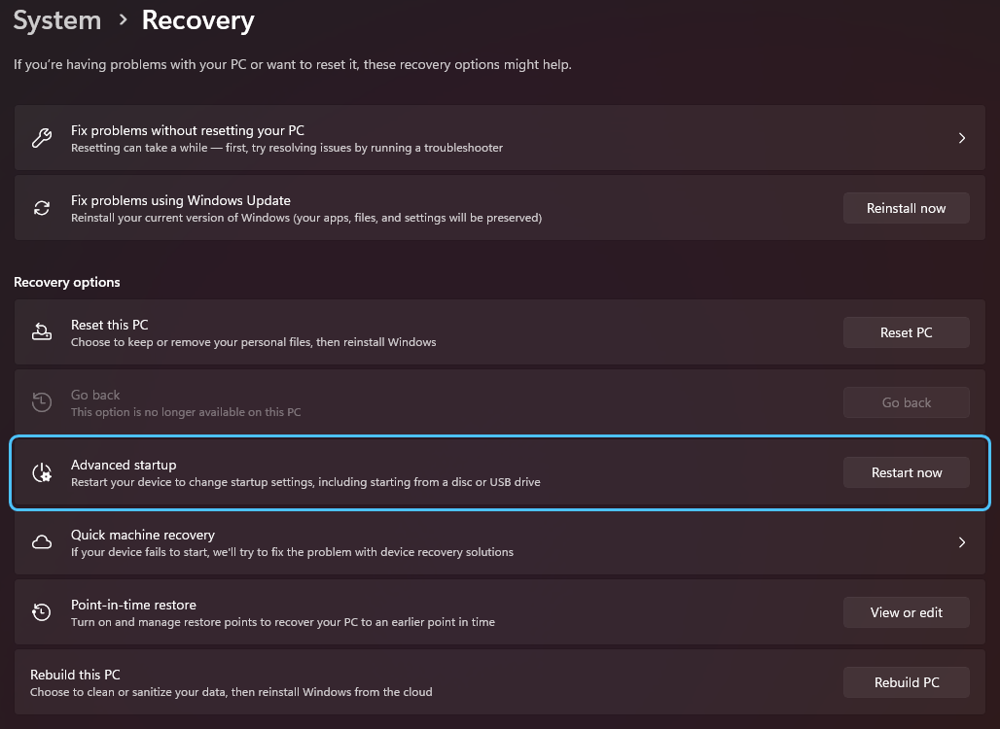

2. Choose **Troubleshoot > Advanced options > UEFI Firmware Settings > Restart**
   (or press Del, F2, F10 or Esc while the PC starts).
3. Turn on **Intel Virtualization Technology (VT-x)** or **AMD SVM Mode**. It's often
   under Advanced, CPU Configuration or Security.
4. Save, exit, and open Try Linux again.

Setup can still download and prepare a system before you change the setting; click
**Install** on the home page afterwards.

**"Windows Hypervisor Platform is turned off"**
Let Try Linux turn it on (Windows asks for permission), or do it yourself: press Win+R,
type `optionalfeatures`, tick **Windows Hypervisor Platform**, click **OK**, then restart.


If **Hyper-V** is already on, Try Linux may work without this box ticked; it only asks
when it can't start a VM.

**"Windows Hypervisor Platform is turned on but isn't running yet"**
Restart Windows. If the message comes back after restarting, virtualization is
probably off in the BIOS/UEFI; follow the steps above.

**"This PC's processor doesn't support hardware virtualization"**
Try Linux can't run on this PC.

## Limitations

- No camera or USB passthrough, and no choice of sound device (Windows defaults
  are used). WINQ-EMU doesn't support these.
- No clipboard sharing or drag-and-drop between Windows and Linux.
- Chromium-based browsers can show black video in the guest; Firefox works best.
- WINQ-EMU is alpha software.

## Building from source

Try Linux uses the C# compiler that ships with Windows, so nothing needs installing:

```bat
build.cmd
```

This produces `TryLinux.exe` from `TryLinux.cs` and `Settings.cs`.

`try-linux-vm.ps1` is a standalone PowerShell script that does the same VM setup
from the command line.

## Credits

- [WINQ-EMU](https://github.com/cmspam/winq-emu) by cmspam: QEMU (GPL-2.0),
  virglrenderer (MIT), launcher (MIT). Downloaded by Try Linux, not redistributed.
- Inspired by [Try Omarchy for Windows](https://github.com/omacom/try-omarchy-windows).
- Linux distributions are downloaded from their official mirrors and carry their own licenses.

## License

Try Linux is released under the [MIT License](LICENSE).
