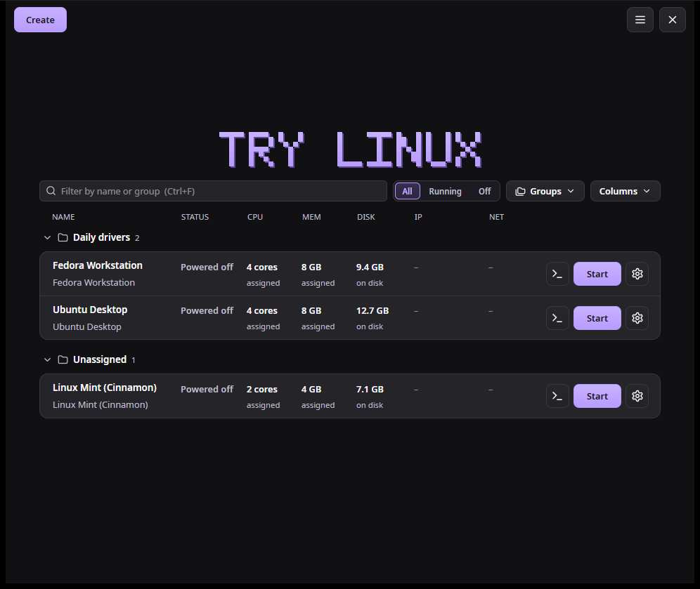

# Try Linux

Try a Linux desktop without repartitioning your drive. Pick a distribution, and Try Linux downloads the official
installer, checks it against the distribution's published SHA-256 or SHA-512 checksum, creates a virtual disk and
starts the installer in a window. Your systems keep running in the background, and Try Linux updates itself.



- **Your systems at a glance:** live CPU, memory, disk and network activity, IP addresses, and more columns to
  choose from; sort, filter, drag to rearrange, and put systems in groups.
- **Send keys** like Ctrl+Alt+Del, take screenshots, and on Linux, **suspend** a system and resume it where you left
  it.
- **Settings for each system:** displays and graphics, memory and cores, disks and snapshots, UEFI or BIOS, the
  network, a shared folder and the clipboard, with a search across them all.
- **Bring your own:** import a machine from VirtualBox, VMware or Hyper-V (.ova or its disk), or use any ISO.
- **Recovery:** backups, clones, snapshots, reset, and a log of each system's starts and stops.

## Download

| For | Runs on | Download | Guide |
| --- | --- | --- | --- |
| **Windows** | Windows 10 and 11 (x64) | [`TryLinux-<version>-Setup.exe`](https://github.com/donnysaengkio/try-linux/releases/latest) | [Try Linux for Windows](docs/windows.md) |
| **Linux** | x86_64 and ARM64, any distribution | [`TryLinux-<version>-<arch>.AppImage`](https://github.com/donnysaengkio/try-linux/releases?q=linux-v&expanded=true) | [Try Linux for Linux](docs/linux.md) |
| **Mac** | Apple silicon, macOS 13 or later | [`TryLinux-<version>-macOS.zip`](https://github.com/donnysaengkio/try-linux/releases?q=macos-v&expanded=true) | [Try Linux for Mac](docs/macos.md) |

On Windows, systems run with [WINQ-EMU](https://github.com/cmspam/winq-emu) (QEMU on the Windows Hypervisor
Platform, with OpenGL and Vulkan graphics); on Linux, with your distribution's QEMU and KVM; on the Mac, with Apple's
Virtualization framework.

Try Linux 2 is one app for all three, built with [Tauri](https://tauri.app). It replaces the separate Windows 1.x,
Linux 1.0.x and Mac 1.x apps, which update to it on their own and keep your systems.

## The distribution catalog

Choose a Linux OS recommends five distributions and searches hundreds more, from two lists here, each entry with
its official mirror, how to find the newest installer there and its checksum file:

- [`catalog/distros.json`](catalog/distros.json): x86_64 installers, and over 400 distributions from DistroWatch
  that you download from their website.
- [`catalog/distros-aarch64.json`](catalog/distros-aarch64.json): ARM64 installers (the Mac, and Linux on ARM64).

Try Linux checks them when you open Choose a Linux OS, so new entries appear without a new release.

## For developers

See [Developing Try Linux](docs/development.md): the repository's layout, building and running, the tests, and
making a release.

```
src-tauri/   the Rust side
ui/          the interface (React and TypeScript)
scripts/     building and signing releases
packaging/   the stand-in Linux 1.0.x updates to
catalog/     the distribution lists (every released app reads them from here)
icons/       the shared icons
docs/        the guides and their screenshots
```

## License

MIT. See [LICENSE](LICENSE).
