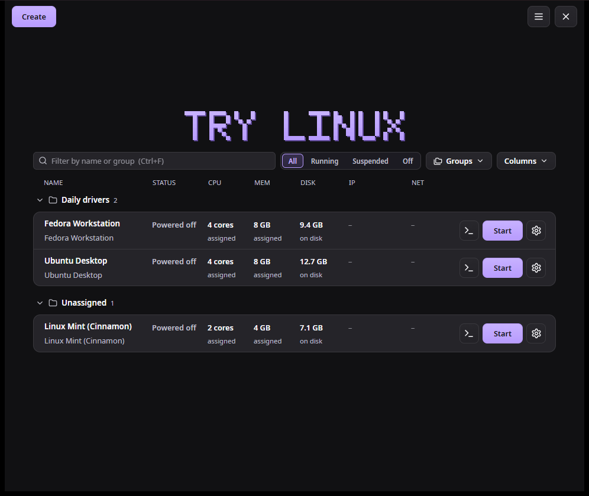

# Try Linux for Mac

Try a Linux desktop on your Mac without touching macOS. Pick a distribution, and Try Linux downloads the official
ARM64 installer, checks it against the distribution's published checksum, creates a virtual disk and starts the
installer in a window. Systems run with Apple's Virtualization framework, at close to native speed.

It's the same app as [Try Linux for Windows](windows.md) and [Try Linux for Linux](linux.md), and version 2 replaces
Try Linux 1.x for Mac. 1.x moves to it on its own: see [Updating from 1.x](#updating-from-1x).

*The screenshots are from Windows; the Mac looks the same.*

## Requirements

- A Mac with Apple silicon (M1 or later)
- macOS 13 Ventura or later
- About 20 GB of free space per system, and internet access to download Linux

Linux runs as ARM64, so Choose a Linux OS lists the distributions that publish ARM64 installers.

## Install

1. Download `TryLinux-<version>-macOS.zip` from the newest
   [`macos-v` release](https://github.com/donnysaengkio/try-linux/releases?q=macos-v&expanded=true), and open it.
2. Move **Try Linux** to your **Applications** folder.
3. Open it. Try Linux isn't notarized by Apple, so the first time, macOS says it can't check it. Open **System
   Settings > Privacy & Security**, scroll down, and click **Open Anyway** next to Try Linux. macOS asks once more;
   click **Open**.

Try Linux updates itself from then on: it checks when it opens, and **Check For Updates** is in the main menu (☰).

## Updating from 1.x

Try Linux 1.x for Mac offers the update itself: accept it, and it replaces itself with version 2 in place. Your
systems, downloads and preferences stay where they are, and version 2 opens them as they were.

## What's different on the Mac

- **Systems stop when Try Linux quits.** Apple's framework runs them inside the app, so there's no "keep running"
  choice. Close the window instead, and Try Linux stays in the menu bar while they run.
- **Not yet on the Mac:** Suspend, Send Keys, Take Screenshot, and choosing UEFI or BIOS (systems always start with
  UEFI). The guest agent's columns (network traffic, hostname, Linux version) show "–"; the IP address comes from
  the Mac's own records.
- **The clipboard** is shared with Linux through spice-vdagent, which most Linux desktops include.

## Uninstall

Quit Try Linux and move it from **Applications** to the Trash. Your systems are in
`~/Library/Application Support/TryLinux`; delete that folder too to remove them.
