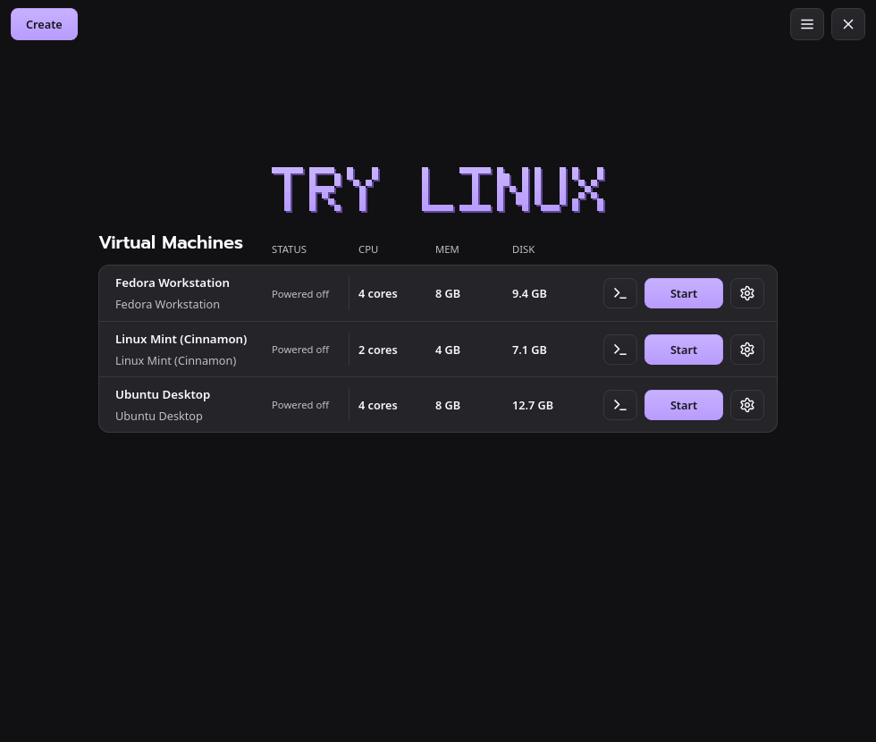
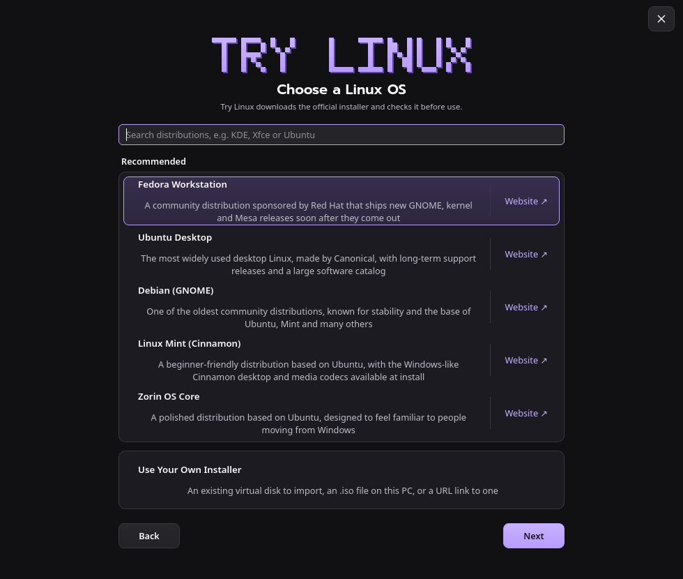
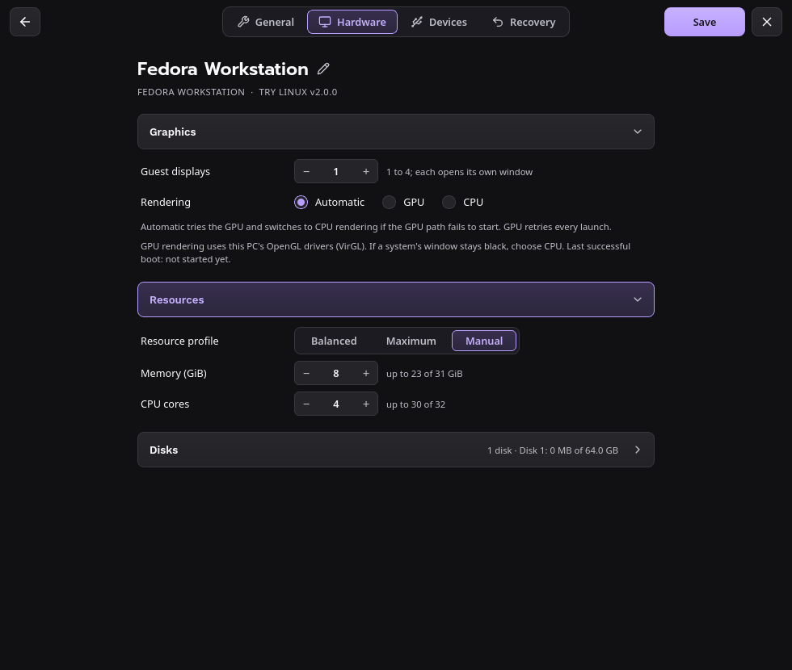
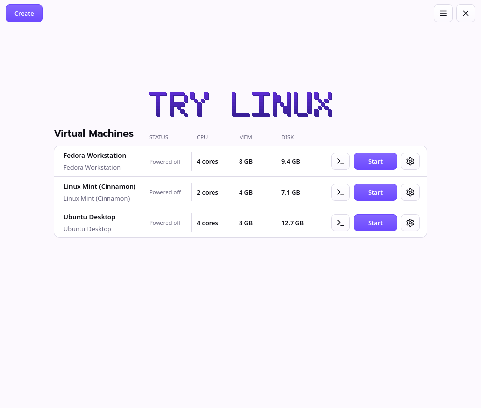

# Try Linux for Linux

Try another Linux distribution on your Linux PC without repartitioning your drive. Pick a distribution, and Try
Linux downloads the official installer, checks it against the distribution's published SHA-256 or SHA-512
checksum, creates a virtual disk and starts the installer in a window. It uses QEMU with KVM, so systems run at
close to native speed, with 3D acceleration (VirGL) where your graphics drivers support it.

It runs on **x86_64** and **ARM64** (aarch64) PCs, as one AppImage for each that works on any distribution and
updates itself. It's the same app as [Try Linux for Windows](README.md), and version 2 replaces Try Linux 1.0.x
for Linux. 1.0.x moves to it on its own: see [Updating from 1.0.x](#updating-from-10x).



| | |
|---|---|
|  |  |
| **Choose a Linux OS:** five recommended distributions (four on ARM64), and a search of hundreds more | **Settings:** General, Hardware, Devices and Recovery, as on Windows |
|  | |
| **Light theme**, or Dark, or following your desktop | |

## Requirements

- An x86_64 or ARM64 PC running Linux, with a graphical desktop.
- **QEMU**, from your distribution, with **KVM**: virtualization (Intel VT-x / AMD-V) turned on in your PC's
  firmware settings, and access to `/dev/kvm` (on most distributions, being in the `kvm` group).
- About 20 GB of free space per system, and internet access to download Linux.

Ubuntu / Debian:

```bash
sudo apt install qemu-system-x86 qemu-utils qemu-system-gui
```

On ARM64, use `qemu-system-arm qemu-efi-aarch64` in place of `qemu-system-x86`.

Fedora:

```bash
sudo dnf install qemu-kvm qemu-img qemu-ui-gtk qemu-ui-opengl qemu-audio-pipewire qemu-device-display-virtio-vga-gl
```

On ARM64, use `qemu-device-display-virtio-gpu-gl edk2-aarch64` in place of `qemu-device-display-virtio-vga-gl`.

Arch:

```bash
sudo pacman -S qemu-desktop
```

On ARM64, add `edk2-aarch64`.

If you aren't in the `kvm` group yet, add yourself, then sign out and back in:

```bash
sudo usermod -aG kvm $USER
```

Nothing else is needed: the AppImage brings its own libraries, and doesn't need FUSE 2.

## Install

1. Download the AppImage for your PC from [the Linux releases](https://github.com/donnysaengkio/try-linux/releases?q=linux-v&expanded=true)
   (the `linux-v…` ones): `TryLinux-<version>-x86_64.AppImage` for most PCs, or `TryLinux-<version>-aarch64.AppImage`
   for ARM64.
2. Put it where you'll keep it, for example `~/Applications`, and make it executable (in your file manager,
   Properties > Allow executing as a program, or `chmod +x TryLinux-*.AppImage`).
3. Open it. The first time, Try Linux adds itself to your apps menu (with its icon) and makes the `try-linux`
   command in `~/.local/bin` start it. No sudo is needed.

These point at the AppImage where it is, so if you move it later, open it once from its new place.

You can check the download against the SHA-256 checksum in the release's `SHA256SUMS.txt`:

```bash
sha256sum TryLinux-*.AppImage
```

## Updates

Each time it opens, Try Linux checks for a new version and shows a notice with an **Update** button when there is
one. **Check For Updates** in the main menu (☰, or Ctrl+U) checks right away; **Preferences** turns the automatic
check off. An update downloads, replaces the AppImage file and opens again; systems that are running keep running.
Try Linux only installs updates signed with its own key, so a changed or damaged download is refused.

## Updating from 1.0.x

Try Linux 1.0.x offers 2.0 as an update like any other: click **Update**.

1. 1.0.x checks the download against the release's checksum and puts it in place. It's a small stand-in that
   downloads the 2.0 AppImage for your PC into `~/.local/share/try-linux`, with a window showing its progress, checks
   it, and starts it.
2. The first time 2.0 starts, it takes over from 1.0.x: your apps menu entry and the `try-linux` command, and the
   apps-menu shortcuts and **Start … when I sign in** entries you made for your systems, now start 2.0, and 1.0.x's
   Python files are removed.

Your systems, downloads and settings carry over as they are: they're the same files, in
`~/.local/share/TryLinux` and `~/.config/TryLinux`. 2.0 doesn't need GTK 4, libadwaita or Python, so you can remove
those if nothing else uses them.

You can also download the AppImage yourself (see [Install](#install)); it takes over 1.0.x the same way.

## Using it

Click **Create** and choose a Linux OS (or **Use Your Own Installer**), then:

1. **General:** the system's name, an optional description, and where it's kept.
2. **Resources:** Balanced, Maximum or Manual memory and CPU cores, and the disk size, with the free space on that
   drive. **Allocate the full size now** takes the disk's whole size straight away, instead of as Linux stores data.
3. **Summary:** everything you chose. **Install** downloads and checks the installer, creates the disk and opens the
   system's window (an imported disk is copied and started).

Install Linux onto the virtual disk as you would on a PC; your own drive is never touched.

**Virtual Machines** lists each system with its status (**Running**, **Paused**, **Powered off** or **Ready to
install**), and while it runs, its CPU use, the memory Linux is using and its disk activity.

- **Start** starts a system in its own QEMU window; **Console** (`>_`) brings a running system's window forward.
- **Closing a system's window** doesn't turn it off: use **Power > Shut down**.
- **Closing Try Linux** while systems run keeps it in the tray (on GNOME, the tray needs the AppIndicator
  extension; without it, open Try Linux from your apps menu to get its window back).
- **Power** replaces Start while a system runs: **Shut down** and **Restart** ask Linux to shut down cleanly,
  **Pause** freezes it, and **Force stop** and **Reset** act at once, losing unsaved work, so they ask first.
- If Try Linux is closed while a system installs, the system keeps going; Try Linux picks it up again the next time
  it opens.

**Settings** (the gear button) has four tabs of sections; click one to open it. Save applies the changes.

- **General:** the name and description, fullscreen, starting the system when you sign in, and adding it to your
  apps menu.
- **Hardware:** guest displays, and GPU (VirGL) or CPU rendering; memory and CPU cores; and the disks, with **Disk
  Utilities** to resize, compact, add and remove disks.
- **Devices:** a CD/DVD drive for ISOs such as drivers or rescue disks (changeable while the system runs), sound and
  microphone (PipeWire or PulseAudio), network type and port forwards (`tcp:2222:22` for this PC,
  `lan tcp:8080:80` for your network), and a shared folder.
- **Recovery:** back up and restore, clone, snapshots, move the storage folder, clean up downloads, reset or boot an
  ISO, and delete.

To use the shared folder in Linux:

```sh
sudo mkdir -p /mnt/host
sudo mount -t 9p -o trans=virtio,version=9p2000.L host /mnt/host
```

**Keyboard shortcuts:** Ctrl+N Create, Ctrl+F search distributions, Ctrl+U Check For Updates, Ctrl+comma
Preferences, Ctrl+? all shortcuts, Ctrl+Q quit, Alt+← back, Esc close a dialog or menu. In a system's window,
**Ctrl+Alt+G** releases the mouse and keyboard and **Ctrl+Alt+F** toggles fullscreen.

## Where things are kept

- Systems: `~/.local/share/TryLinux/vms/<name>/` (`vm.json` and `disk.qcow2`), or the folder you chose in Create.
- Downloaded installers: `~/.local/share/TryLinux/isos/`.
- Try Linux's own settings: `~/.config/TryLinux/settings.json`.

## Uninstall

Quit Try Linux (☰ > Quit Try Linux), then delete the AppImage and what it added:

```bash
rm -f ~/.local/bin/try-linux ~/.local/share/applications/io.github.donnysaengkio.TryLinux.desktop \
  ~/.local/share/icons/hicolor/scalable/apps/io.github.donnysaengkio.TryLinux.svg \
  ~/.local/share/applications/trylinux-*.desktop ~/.config/autostart/trylinux-*.desktop
```

Your systems and downloads stay in `~/.local/share/TryLinux`, and Try Linux's settings in `~/.config/TryLinux`;
delete those folders to remove them too.

## Troubleshooting

- **A system runs very slowly:** KVM isn't in use. Check that virtualization is on in your PC's firmware settings
  and that you're in the `kvm` group (then sign out and back in).
- **A system's window stays black, or 3D doesn't start:** choose **CPU** in **Settings > Hardware > Graphics >
  Rendering**. GPU rendering needs QEMU's OpenGL display (`qemu-system-gui` / `qemu-ui-opengl`) and working OpenGL
  drivers.
- **Try Linux says QEMU isn't installed:** install it with the commands in [Requirements](#requirements).

## License

MIT. See [LICENSE](../LICENSE).
