# Try Linux for Windows

Try a Linux desktop on Windows without repartitioning your drive. Pick a distribution, and Try Linux downloads
the official installer, checks it against the distribution's published SHA-256 or SHA-512 checksum, creates a
virtual disk and starts the installer in a window, with GPU-accelerated graphics.

Try Linux runs your systems with [WINQ-EMU](https://github.com/cmspam/winq-emu), a QEMU build for Windows that
uses the Windows Hypervisor Platform and passes OpenGL / Vulkan graphics through to Linux (VirGL and Venus).

Version 2 is a new app that replaces Try Linux 1.x. It keeps your systems, downloads and settings, and 1.x moves to
it on its own: see [Updating from 1.x](#updating-from-1x).

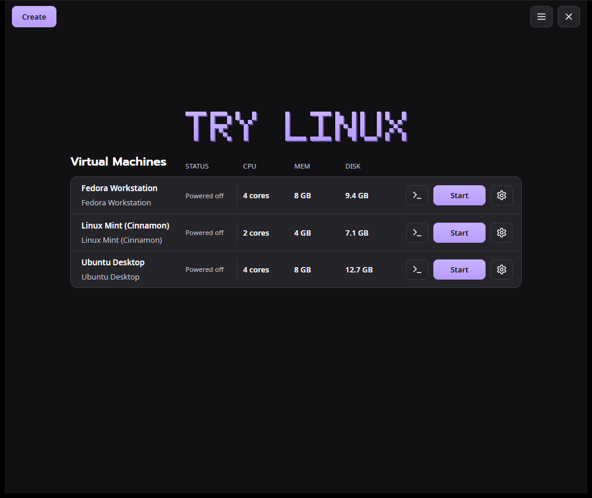

## Screenshots

| | |
|---|---|
| 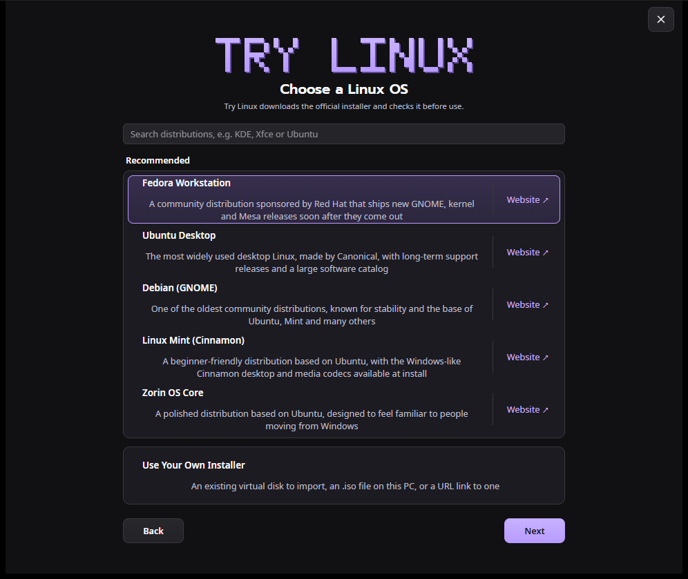 | 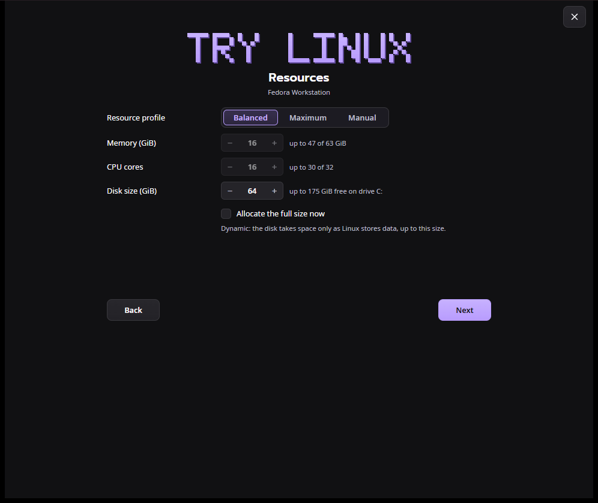 |
| **Choose a Linux OS:** five recommended distributions, and a search of hundreds more | **Create:** name and location, then memory, cores and disk size, then a summary |
| 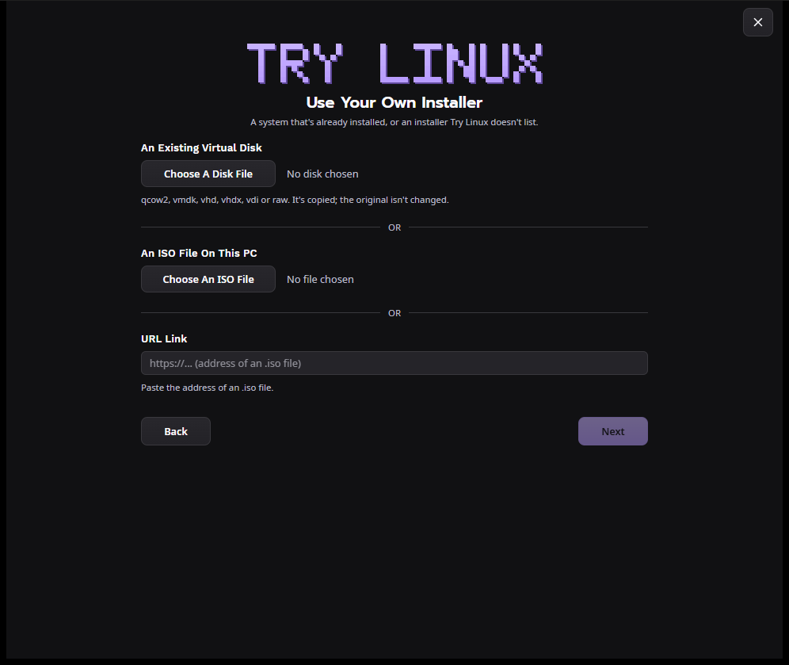 | 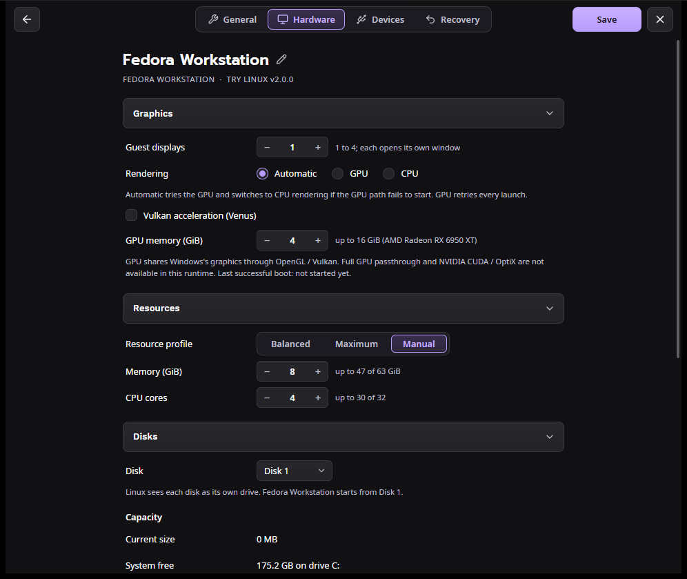 |
| **Use Your Own Installer:** an existing virtual disk, an ISO file or a link | **Settings, Hardware:** displays, rendering, GPU memory, resources, disks |
| 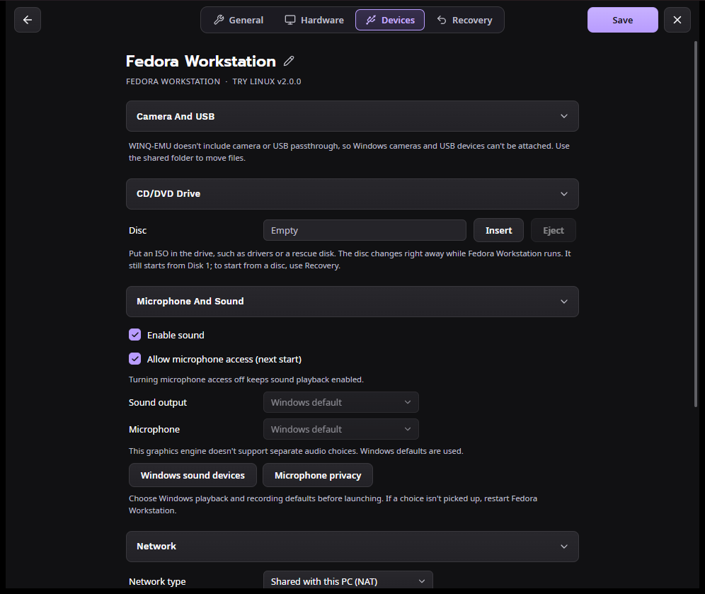 | 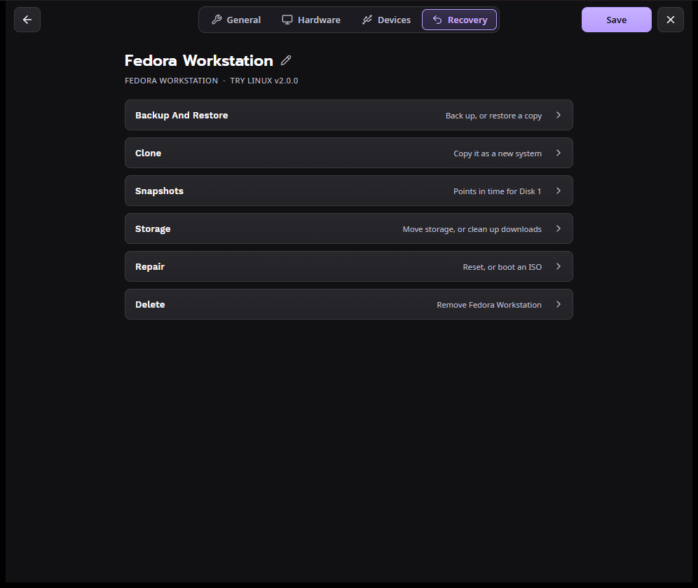 |
| **Settings, Devices:** CD/DVD drive, sound and microphone, network and port forwards, shared folder | **Settings, Recovery:** back up, clone, snapshots, move storage, repair, delete |
| 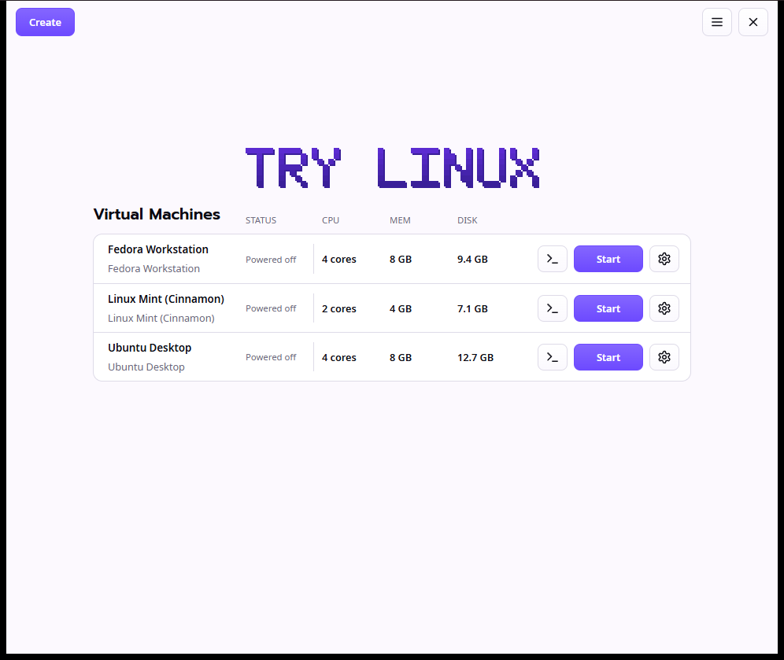 | |
| **Light theme**, or Dark, or following Windows | |

## Requirements

- 64-bit Windows 10 or 11 (ARM64 isn't supported)
- Hardware virtualization turned on in your PC's BIOS/UEFI
- About 20 GB of free space per system
- Internet access to download Linux and WINQ-EMU

## Install

1. Download `TryLinux-<version>-Setup.exe` from
   [the latest release](https://github.com/donnysaengkio/try-linux/releases/latest).
2. Run it. The installer isn't code-signed, so Windows may show **"Windows protected your PC"**: click
   **More info**, then **Run anyway**.

   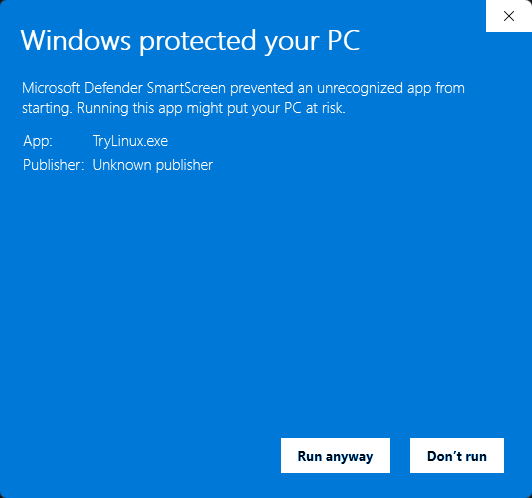

3. Try Linux installs for you alone, in `%LOCALAPPDATA%\Try Linux`, with a **Try Linux** entry in the Start menu.
   It doesn't need administrator permission.

You can check the download against the SHA-256 checksum in the release's `SHA256SUMS.txt`:

```powershell
Get-FileHash .\TryLinux-2.0.0-Setup.exe -Algorithm SHA256
```

**The first time you create a system**, Try Linux checks what your PC still needs and offers to set it up:

1. **Hardware virtualization.** If it's off, Try Linux says how to turn it on (see
   [Troubleshooting](#troubleshooting)). It can still download and prepare the system meanwhile, and the system
   waits, **Ready to install**.
2. **Windows Hypervisor Platform.** Try Linux turns it on; Windows asks for permission, then needs one restart.
3. **WINQ-EMU** (about 55 MB), downloaded from its GitHub releases and installed. It isn't bundled with Try Linux.

## Updates

Each time it opens, Try Linux checks for a new version of itself and of WINQ-EMU, and shows a notice with an
**Update** button when there is one. **Check For Updates** in the main menu (☰, or Ctrl+U) checks right away;
**Preferences** turns the automatic check off.

- **Try Linux updates** download, then Try Linux closes, installs the new version and opens again. Systems that
  are running keep running. Try Linux only installs updates signed with its own key, so a changed or damaged
  download is refused.
- **WINQ-EMU updates** download WINQ-EMU's new installer and run it; Windows asks for permission, because it
  installs to `C:\WINQ-EMU`. Shut down running systems first. WINQ-EMU is alpha software, so its release notes are
  worth a look.

## Updating from 1.x

Try Linux 1.x offers 2.0 as an update like any other: click **Update**. It downloads the 2.0 installer, checks it
against the release's SHA-256 checksum and runs it. You can also run `TryLinux-<version>-Setup.exe` yourself.

The first time 2.0 starts, it takes over from 1.x:

- Your systems, downloads and preferences carry over as they are (they're the same files, in
  `%LOCALAPPDATA%\TryLinux` and `%APPDATA%\TryLinux`).
- Desktop shortcuts and "start at sign-in" entries made by 1.x now open 2.0.
- 1.x's Start menu entry, its entry in Installed apps and its program folder (`%LOCALAPPDATA%\Programs\TryLinux`)
  are removed. If 1.x is still open, this waits until it's closed.

A system that 1.x started keeps running; 2.0 shows it as running and can control it once 1.x has closed.

## Using it

Click **Create** and choose a Linux OS (or **Use Your Own Installer**), then:

1. **General:** the system's name, an optional description, and where it's kept.
2. **Resources:** Balanced, Maximum or Manual memory and CPU cores, and the disk size, with the free space on that
   drive. **Allocate the full size now** takes the disk's whole size straight away, instead of as Linux stores
   data.
3. **Summary:** everything you chose. **Install** downloads and checks the installer, creates the disk and opens
   the system's window (an imported disk is copied and started).

Install Linux onto the virtual disk as you would on a PC; your Windows drive is never touched.

**Virtual Machines** lists each system with its status (**Running**, **Paused**, **Powered off** or **Ready to
install**), and while it runs, its CPU use, the memory Linux is using and its disk activity.

- **Start** starts a system in its own window; **Console** (`>_`) brings a running system's window to the front.
- **Closing a system's window** keeps it running: Console brings it back.
- **Closing Try Linux** while systems run keeps it in the tray. Right-click the tray icon to show a system's
  window, use its power commands, or open Try Linux.
- **Power** replaces Start while a system runs: **Shut down** and **Restart** ask Linux to shut down cleanly,
  **Pause** freezes it, and **Force stop** and **Reset** act at once, losing unsaved work, so they ask first.
- **Several systems can run at once**, each with the memory and cores it was given.
- If Try Linux is closed while a system installs, the system keeps going; Try Linux picks it up again the next
  time it opens, and when an install finished meanwhile, Start asks whether to start from the disk.

**Settings** (the gear button) has four tabs of sections; click one to open it. Save applies the changes.

- **General:** the name and description, fullscreen and which display, starting at Windows sign-in, and a desktop
  shortcut.
- **Hardware:** guest displays, GPU or CPU rendering, Vulkan and GPU memory; memory and CPU cores; and the disks,
  with **Disk Utilities** to resize, compact, add and remove disks.
- **Devices:** a CD/DVD drive for ISOs such as drivers or rescue disks (changeable while the system runs), sound
  and microphone, network type and port forwards (`tcp:2223:22` for this PC, `lan tcp:8080:80` for your network),
  and a shared Windows folder.
- **Recovery:** back up and restore, clone, snapshots, move the storage folder, clean up downloads, reset or boot
  an ISO, and delete.

To use the shared folder in Linux:

```sh
sudo mkdir -p /mnt/host
sudo mount -t 9p -o trans=virtio,version=9p2000.L host /mnt/host
```

**Keyboard shortcuts:** Ctrl+N Create, Ctrl+F search distributions, Ctrl+U Check For Updates, Ctrl+comma
Preferences, Ctrl+? all shortcuts, Ctrl+Q quit, Alt+← back, Esc close a dialog or menu. In a system's window,
**Ctrl+Alt+G** releases the mouse and keyboard and **Ctrl+Alt+F** toggles fullscreen.

## Uninstall

Quit Try Linux (☰ > Quit Try Linux), then use **Windows Settings > Apps > Installed apps > Try Linux >
Uninstall**. Your systems and downloads stay in `%LOCALAPPDATA%\TryLinux`; delete that folder to remove them too.
WINQ-EMU is uninstalled separately, from Installed apps.

## Troubleshooting

**Check first:** open Task Manager (Ctrl+Shift+Esc), go to **Performance > CPU**, and look for **Virtualization**.
It should say **Enabled**.

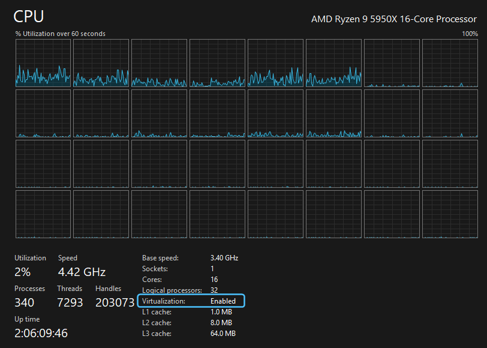

**"Hardware virtualization is turned off in your PC's BIOS/UEFI settings"**

1. Open **Settings > System > Recovery**, and next to **Advanced startup** click **Restart now**.
2. Choose **Troubleshoot > Advanced options > UEFI Firmware Settings > Restart** (or press Del, F2, F10 or Esc
   while the PC starts).
3. Turn on **Intel Virtualization Technology (VT-x)** or **AMD SVM Mode**. It's often under Advanced, CPU
   Configuration or Security.
4. Save, exit, and open Try Linux again. A system that was waiting shows **Install** on Virtual Machines.

**"Turn on Windows Hypervisor Platform?"** Click **Turn On**; Windows asks for permission, then needs one restart.
Or do it yourself: press Win+R, type `optionalfeatures`, tick **Windows Hypervisor Platform**, click **OK**, and
restart.

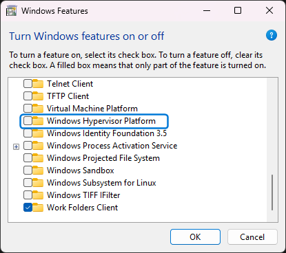

**"Windows Hypervisor Platform is turned on but isn't running yet"** Restart Windows. If the message comes back,
virtualization is probably off in the BIOS/UEFI; follow the steps above.

**"This PC's processor doesn't support hardware virtualization"** Try Linux can't run on this PC.

## Limitations

- No camera or USB passthrough, and no choice of sound device (Windows' defaults are used). WINQ-EMU doesn't
  support these.
- No clipboard sharing or drag-and-drop between Windows and Linux. Use the shared folder, or SSH
  (`ssh -p 2223 you@localhost`).
- Chromium-based browsers can show black video in Linux; Firefox works best.
- WINQ-EMU is alpha software.

## Credits

- [WINQ-EMU](https://github.com/cmspam/winq-emu) by cmspam: QEMU (GPL-2.0), virglrenderer (MIT), launcher (MIT).
  Downloaded by Try Linux, not redistributed.
- Built with [Tauri](https://tauri.app), [React](https://react.dev), [Base UI](https://base-ui.com) and
  [Sonner](https://sonner.emilkowal.ski); icons from [Lucide](https://lucide.dev).
- Linux distributions are downloaded from their official mirrors and carry their own licenses.
- Fonts under the SIL Open Font License 1.1 (see `ui/public/fonts`): Prompt by Cadson Demak, Work Sans by Wei
  Huang and Noto Sans by the Noto Project Authors.

Try Linux is released under the [MIT License](../LICENSE).

---

# For developers

This folder is Try Linux as **one app for Windows, macOS and Linux**, built with Tauri. The interface in
[`ui/`](ui) is React and TypeScript, the same on every platform, and [`src-tauri/`](src-tauri) is the Rust side
that does the work. It uses each platform's own web view (WebView2, WKWebView, WebKitGTK), so the app stays small
(about 12 MB on Windows). Windows is released as Try Linux 2.x; macOS and Linux are in progress.

## Each platform

On ARM64 (Apple silicon, ARM Linux) the built-in distributions and the catalog are the ARM64 ones, as on the Mac
edition. Each edition's own folders and files, so the app opens the systems that edition made (see `src-tauri/src/paths.rs`
and `config.rs`):

| | Windows | Linux | macOS |
| --- | --- | --- | --- |
| Systems run with | WINQ-EMU (QEMU, WHPX) | QEMU with KVM, in its GTK window | Apple's Virtualization framework |
| A system's settings | `vm.ini` | `vm.json` | `config.json` |
| Disk 1 | `<id>.qcow2` | `disk.qcow2` | `disk.img` (raw) |
| Try Linux's preferences | `%APPDATA%\TryLinux\settings.ini` | `~/.config/TryLinux/settings.json` | the Mac edition's defaults |
| Shortcut / at sign-in | desktop `.lnk` / Run key | app launcher / autostart `.desktop` | none / login agent |
| Status | works | builds and passes its tests in CI | builds in CI (signed for the Virtualization framework); not yet run on a Mac |

[`.github/workflows/prototype.yml`](../.github/workflows/prototype.yml) builds it on Linux (x86_64 and ARM64) and
macOS, runs the tests (on Linux also the disk and Recovery tests, on scratch systems), and keeps each build as an
artifact.

## How it matches the 1.x edition (Windows)

- **Virtual Machines** lists the systems the Windows edition made (their `vm.ini` files) and starts them with
  WINQ-EMU the same way, with the Power menu (shut down, restart, pause, force stop, reset) and the console.
  Running systems show live CPU, the memory Linux is using and disk activity. A system started by the Windows
  edition shows as running here, but only that copy controls it.
- **The main menu (☰)**: Check For Updates (Try Linux, then WINQ-EMU), Preferences
  (Dark, Light or Follow system, kept in `settings.ini` so both editions match), Keyboard Shortcuts, About, and
  Quit, with the Windows edition's shortcuts (Ctrl+N, Ctrl+F, Ctrl+U, Ctrl+comma, Ctrl+?, Ctrl+Q, Alt+Left).
- A system's close button hides its window; it keeps running, and the tray icon's menu controls it.
  Closing Try Linux while systems run keeps it in the tray.
- **Settings** has the Windows edition's four tabs and sections. Save writes the settings back to the system's
  `vm.ini` (only the keys Settings changes), so either edition reads them; a disc goes in or out of the drive
  at once. A desktop shortcut and starting at sign-in use the same names as the Windows edition's, and run
  Try Linux with `--start <system>`, which starts it and stays in the tray (a second Try Linux hands over to
  the one running). The disk utilities resize, compact (checked against the original before it's replaced),
  add and remove disks. Recovery backs up and restores, clones, takes and reverts snapshots, moves the storage
  folder (deleting the old one only once the copy is complete), cleans up installers, resets, boots an ISO and
  deletes, as the Windows edition does.
- **Create → Choose a Linux OS** shows the recommended distributions and searches the full catalog from
  [`../catalog/distros.json`](../catalog/distros.json). Then General, Resources and Summary, and Install:
  it finds the current installer on the distribution's mirror, downloads it (resuming a partial download),
  checks it against the official SHA-256 or SHA-512 checksum, makes the disk and `vm.ini` as the Windows
  edition does, and starts the installer. **Use Your Own Installer** takes an ISO file, a URL to one (downloaded
  first), or an existing virtual disk (qcow2, VMDK, VHD/VHDX, VDI or raw), copied into a new system with the
  name, memory and cores saved beside it by Try Linux, VMware or VirtualBox.
- **Before Install**, as on Windows: Linux needs hardware virtualization (checked without admin rights); Windows
  Hypervisor Platform is turned on with Windows' permission (one restart); WINQ-EMU is downloaded from GitHub and
  installed during setup, and Check for Updates can update it. A system made before Linux can run waits, ready
  to install.
- Icons are the shared Lucide set in [`../icons`](../icons); fonts and colours match the Windows edition.

On macOS and Linux the same pages run on their own back ends (`mac.rs`, and QEMU with KVM in `vm.rs`); see the
table above for how far each has got.

## The interface's libraries

Unstyled building blocks, drawn with Try Linux's own colours and fonts (`ui/src/style.css`):

| Library | Used for |
| --- | --- |
| [Base UI](https://base-ui.com) | Menus, dialogs, tabs, drop-downs, check boxes and number fields: keyboard use, focus and screen readers |
| [Sonner](https://sonner.emilkowal.ski) | Notifications |

| File | What it does |
| --- | --- |
| `src-tauri/src/main.rs` | The commands the interface calls, and the tray |
| `src-tauri/src/config.rs` | A system's settings, in each edition's own file (`vm.ini`, `vm.json`, `config.json`) |
| `src-tauri/src/paths.rs` | Where each platform keeps systems, installers and Try Linux's preferences |
| `src-tauri/src/mac.rs` | macOS: running systems with Apple's Virtualization framework, each in its own window |
| `src-tauri/src/vm.rs` | Starting QEMU, the power actions, and what happens when it stops |
| `src-tauri/src/disks.rs` | Disk Utilities: resizing, compacting, adding and removing disks |
| `src-tauri/src/live.rs` | Memory and disk activity from QEMU (balloon statistics, block statistics) |
| `src-tauri/src/app.rs` | Preferences, About's details, and checking WINQ-EMU for updates |
| `src-tauri/src/create.rs` | Create: finding, downloading and checking installers, and making the system |
| `src-tauri/src/recovery.rs` | Recovery: back up, restore, clone, snapshots, move, clean, reset, boot an ISO, delete |
| `src-tauri/src/settings.rs` | Settings: reading and saving them, a disk's details, the disc in the drive |
| `src-tauri/src/setup.rs` | What the PC needs: virtualization, Windows Hypervisor Platform, and installing WINQ-EMU |
| `src-tauri/src/shortcuts.rs` | A system's desktop shortcut and starting it at sign-in |
| `src-tauri/src/window.rs` | Systems' windows: bringing them to the front, hiding them from their close button |
| `ui/src/main.tsx` | Which page shows, and messages from the Rust side |
| `ui/src/Home.tsx`, `ui/src/Choose.tsx` | Virtual Machines, and Choose a Linux OS |
| `ui/src/Create.tsx`, `ui/src/distros.ts` | Create's steps and progress; the distributions and where their installers are |
| `ui/src/OwnInstaller.tsx` | Use Your Own Installer |
| `ui/src/Settings.tsx`, `ui/src/Form.tsx` | Settings, and its sections and controls |
| `ui/src/MainMenu.tsx` | The main menu, its windows and the keyboard shortcuts |
| `ui/src/DiskTools.tsx` | The Disk Utilities' dialogs |
| `ui/src/Ask.tsx`, `ui/src/power.ts` | Questions and problems; the power commands and which ask first |
| `ui/src/tauri.ts` | The Rust side's commands and events, typed |

## Build and run (Windows)

Needs [Rust](https://rustup.rs), Visual Studio Build Tools with the C++ workload, and [Node.js](https://nodejs.org)
(LTS).

```bash
cd prototype/ui
npm install
npm run build
cd ../src-tauri
cargo run --release
```

`npm run build` puts the interface in `ui/dist`, which the app includes when Cargo builds it, so run it again
after changing anything in `ui/`.

## Releasing (Windows)

Since 2.0.0 this is **Try Linux for Windows**: an installer (NSIS, installed for the current user in
`%LOCALAPPDATA%\Try Linux`) that updates itself, and that takes over from the 1.x edition in [`../windows`](../windows):

1. Raise `version` in `src-tauri/tauri.conf.json` (and in `src-tauri/Cargo.toml`).
2. Run `scripts/release-windows.ps1 -Notes "What's new"`. It builds the installer into `dist/`, signs it for updates
   with the private key in `%USERPROFILE%\.tauri\try-linux-updates.key`, and writes `SHA256SUMS.txt` and
   `latest.json`.
3. Publish a release tagged `v<version>` (Latest) with `TryLinux-<version>-Setup.exe`, `TryLinux.exe` and
   `SHA256SUMS.txt`, and upload `latest.json` to the `tauri-updates` release (replacing the last one). Installed
   copies read it from there.

Keep the private key safe and out of the repository: installed copies only accept updates signed with it, so
without it they can't be updated. Its public half is in `tauri.conf.json`.

**From 1.x:** the 1.x edition updates to the newest `v…` release by swapping its `TryLinux.exe` for that release's
`TryLinux.exe` (checked against `SHA256SUMS.txt`) and running it. That file is this installer, so 1.x users get 2.x
by clicking Update. On its first start (and each start until it's done) Try Linux then points 1.x's desktop
shortcuts and start-at-sign-in entries to itself and removes 1.x's Start menu entry, its Installed apps entry and
`%LOCALAPPDATA%\Programs\TryLinux` (see `src-tauri/src/legacy.rs`). Systems, downloads and preferences are the same
files, so they carry over as they are.

The fonts in `ui/public/fonts` are under the SIL Open Font License (see the `OFL-*.txt` files).
