# Try Linux 1.x for Windows

> **Replaced by [Try Linux for Windows 2.x](../prototype/README.md).** 1.x updates to 2.x on its own (click
> **Update** when it's offered), or download `TryLinux-<version>-Setup.exe` from
> [the latest release](https://github.com/donnysaengkio/try-linux/releases/latest). Your systems carry over.
> This page and the code here describe 1.x, which gets no more updates.

Try a Linux desktop on Windows without repartitioning your drive.
Pick a distribution, and Try Linux downloads the official installer, checks it
against the distribution's published SHA-256 checksum, creates a virtual disk
and boots it with GPU acceleration.

Try Linux is a small launcher around [WINQ-EMU](https://github.com/cmspam/winq-emu),
a QEMU build for Windows that uses the Windows Hypervisor Platform and forwards
OpenGL / Vulkan graphics (VirGL and Venus) to the guest.

Also available: [Try Linux for Mac](../macos/README.md) and
[Try Linux for Linux](../linux/README.md) (preview), in this repository.

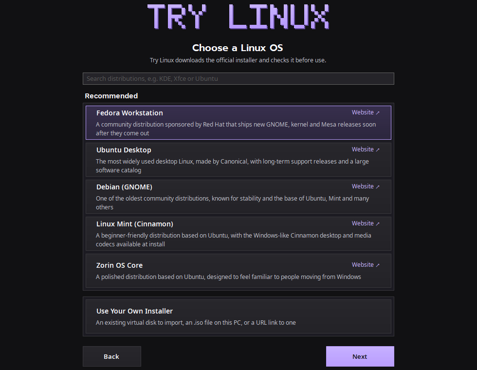

## Screenshots

| | |
|---|---|
| 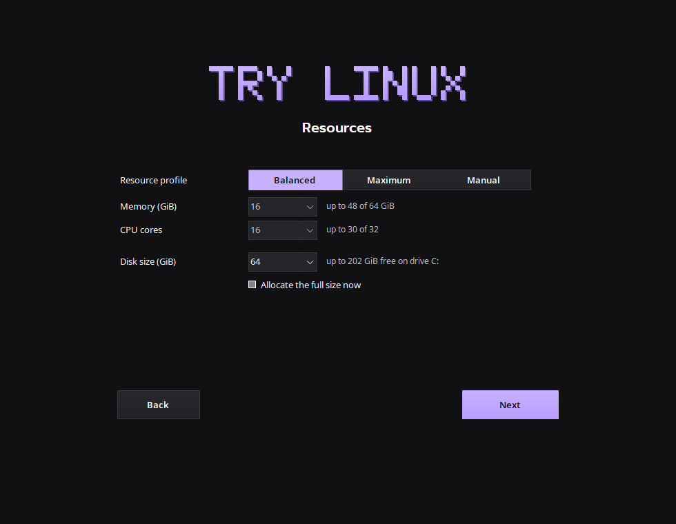 | 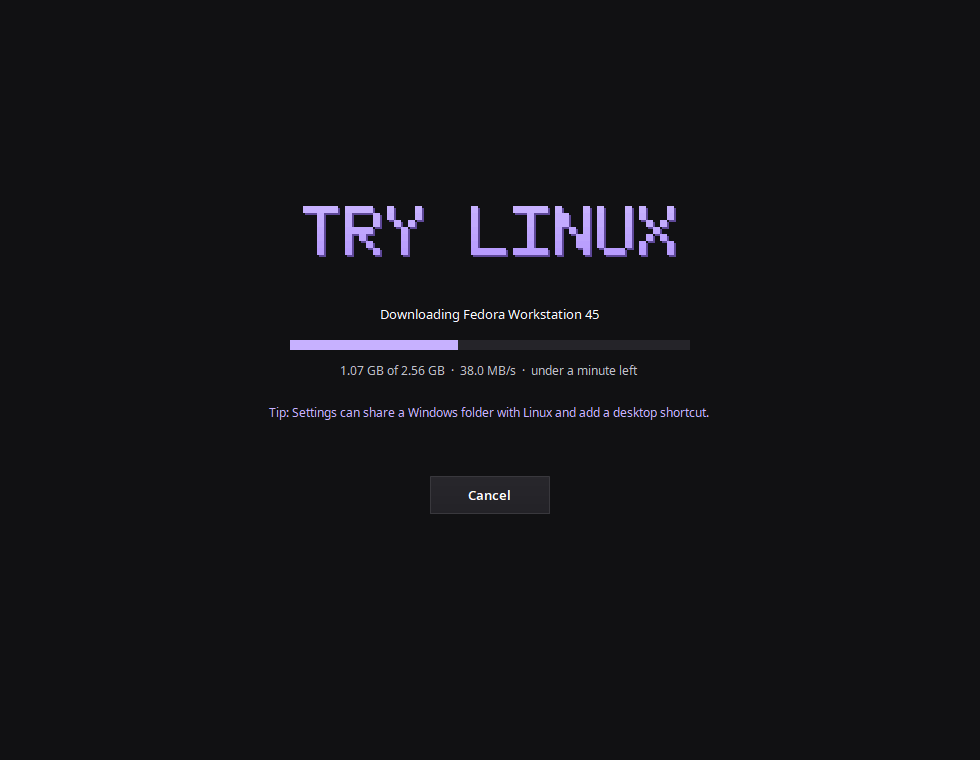 |
| **Create:** name, description and location, then resources and disk size, then a summary | **Download:** the official ISO, checked against its SHA-256 or SHA-512 |
| 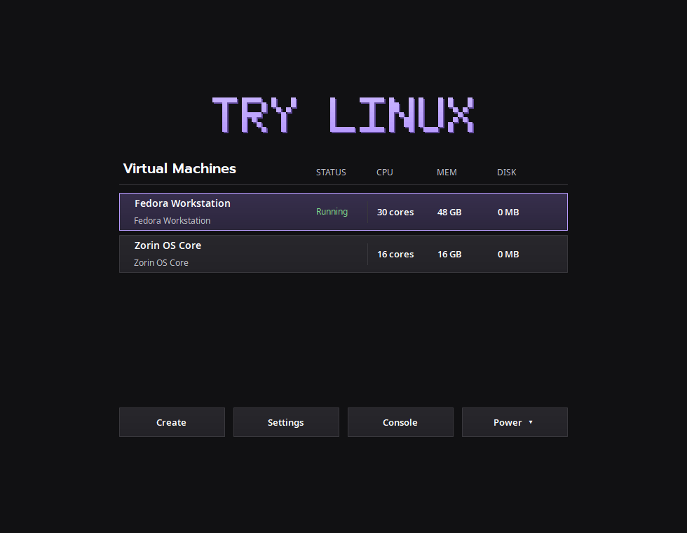 | 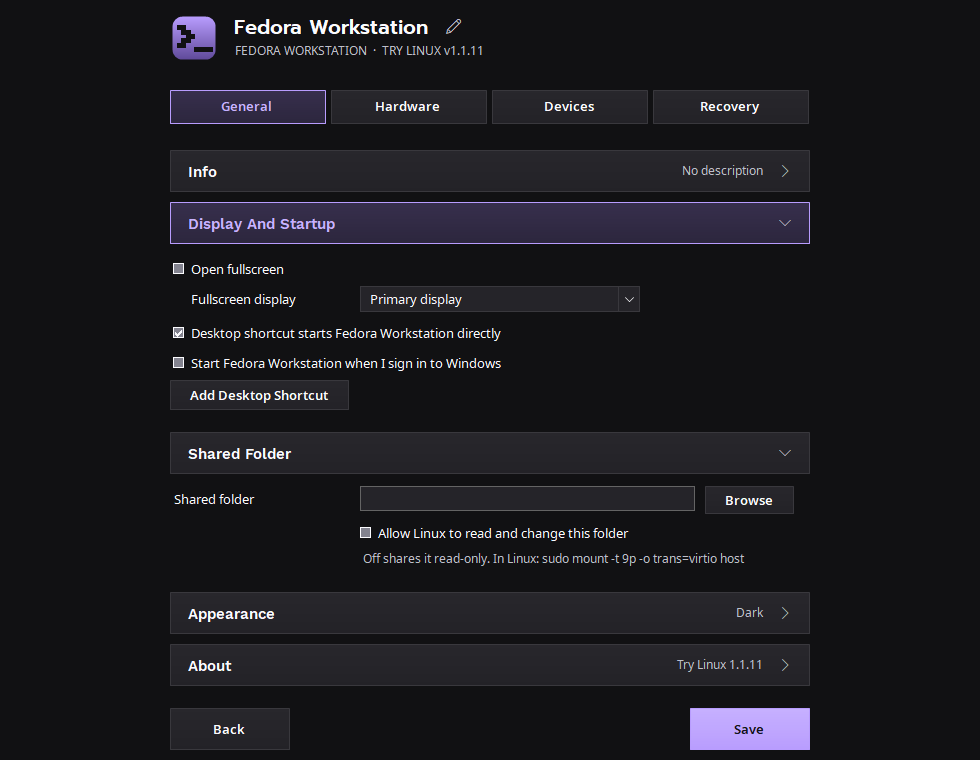 |
| **Virtual Machines:** status, CPU, memory and disk use, start or power commands | **Settings, General:** info and description, display, startup, shared folder, about and updates |
| 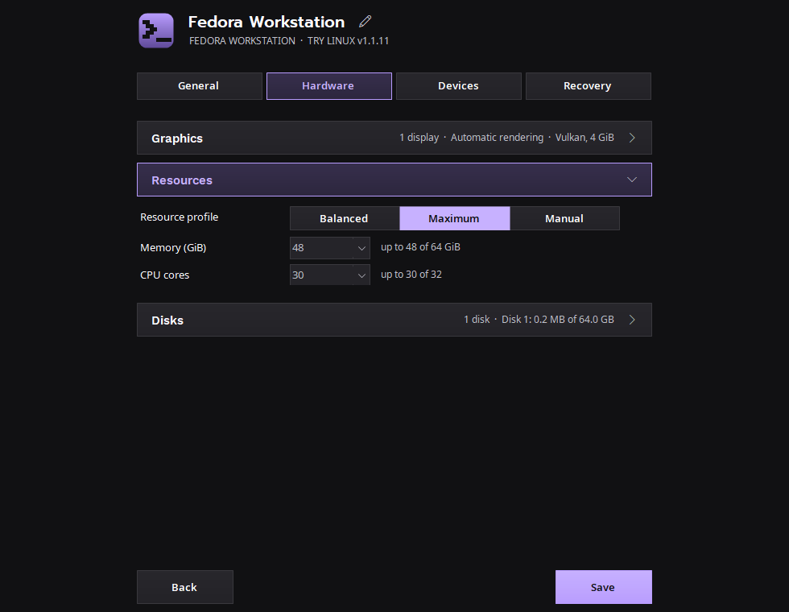 | 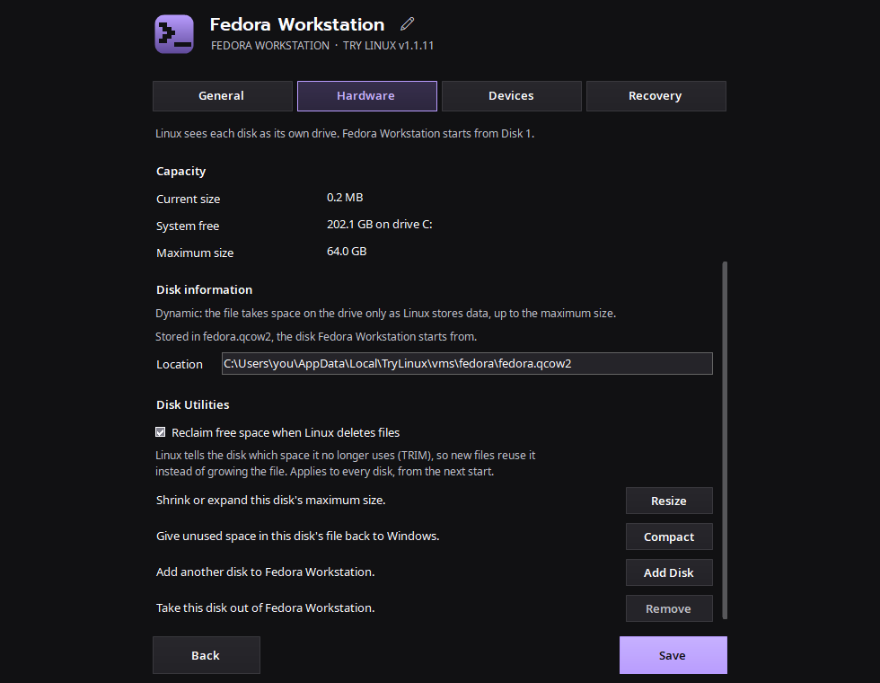 |
| **Settings, Hardware:** graphics, memory and CPU cores, disks | **Disks:** size, location, resize, reclaim free space, compact |
| 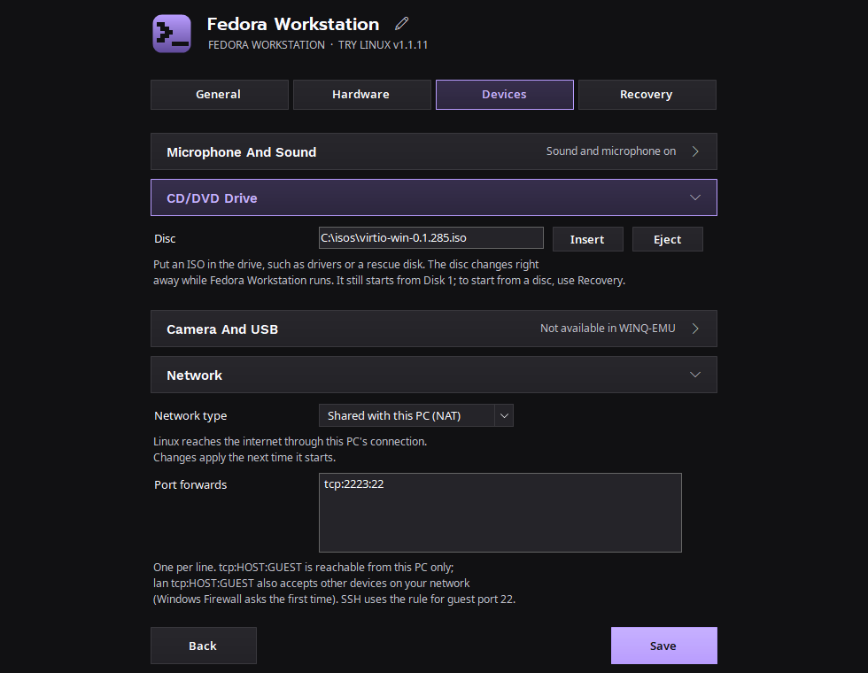 | 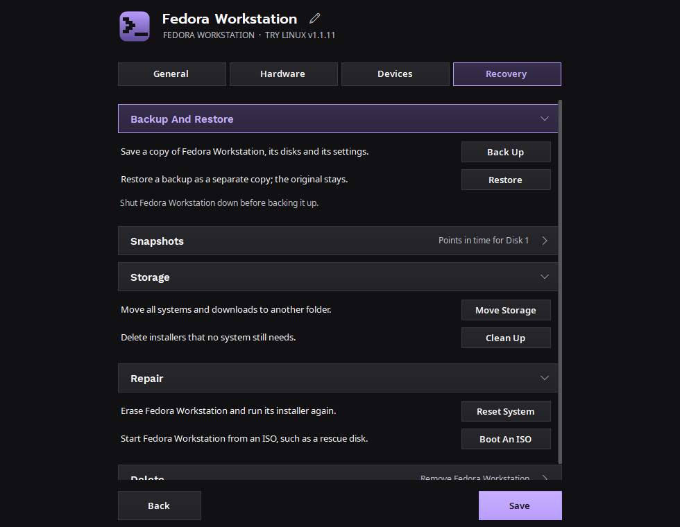 |
| **Settings, Devices:** sound, CD/DVD drive, network type, port forwards | **Settings, Recovery:** backups, snapshots, storage, repair, delete |
| 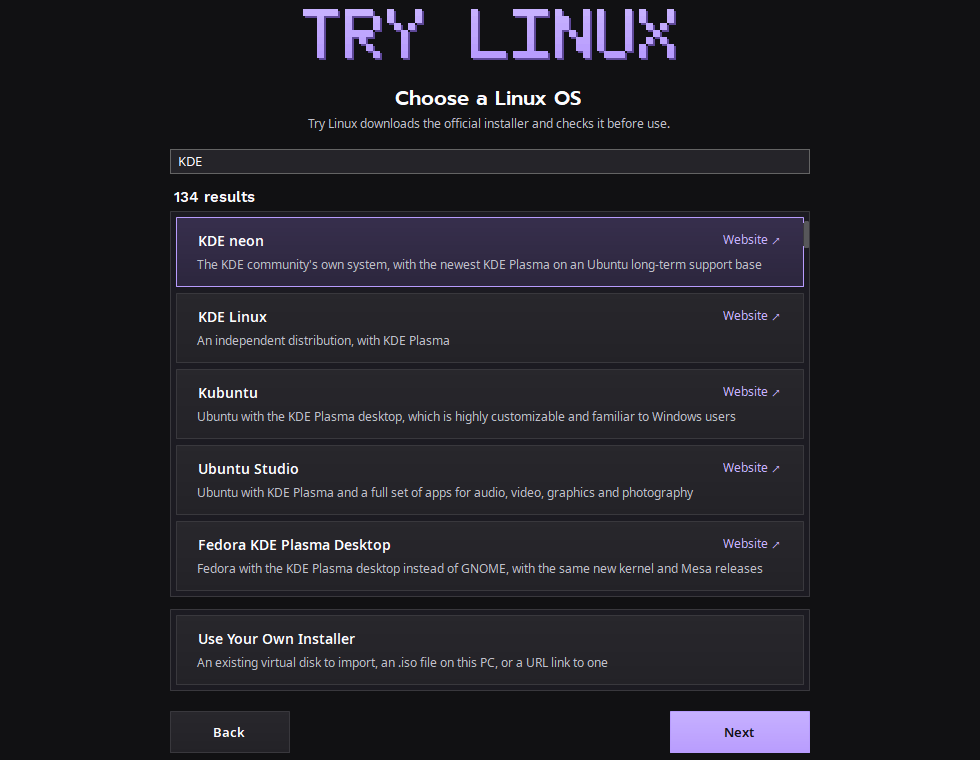 | 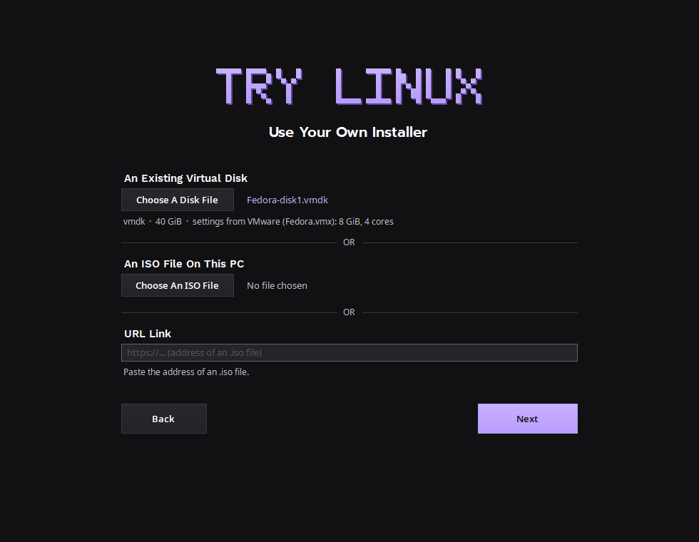 |
| **Search:** over 90 more distributions, editions and atomic versions | **Use Your Own Installer:** an existing virtual disk, an ISO file or a link |
| 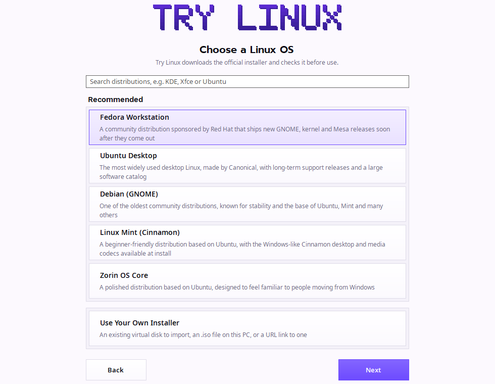 | 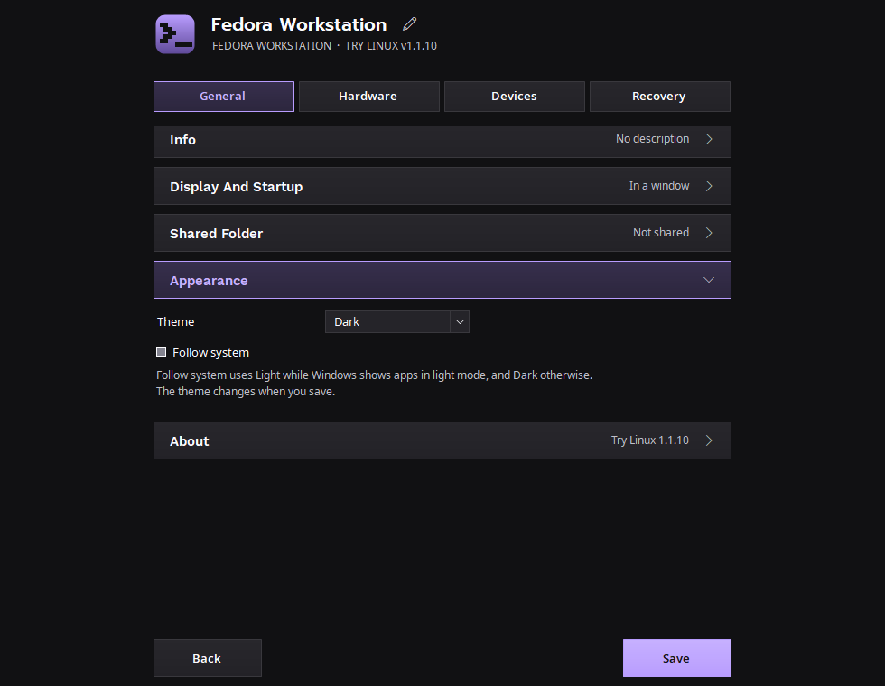 |
| **Light theme** | **Settings > General > Appearance:** Dark or Light, or follow Windows |

## Distributions

Try Linux finds the newest release on each distribution's official mirror when
you install, so it doesn't need updating for new versions.


**Search** (above the list) finds more: over 90 other distributions, desktop
editions and immutable / atomic versions, such as Kubuntu, Xubuntu, Fedora KDE and
Silverblue, Linux Mint Xfce, Debian KDE, openSUSE Tumbleweed, MX Linux, Arch Linux,
Artix, antiX, Alpine, Gentoo, Chimera Linux, Linux Lite, TUXEDO OS, siduction,
Garuda, Parrot, Pardus, PureOS, CentOS Stream, Trisquel, Ultramarine, ALT Linux,
AlmaLinux, Rocky Linux, Bazzite, Bluefin, NixOS, Kali, Solus, Mageia, EndeavourOS
and KDE neon.
Search by name, desktop or description, e.g. `KDE`, `Xfce` or `atomic`. The list
comes from [`catalog/distros.json`](catalog/distros.json) in this repository and is
checked each time you open Choose a Linux OS (only downloaded again when it has
changed), so new entries appear without a new release. Each download is
checked against the distribution's official SHA-256 or SHA-512 checksum.

Search also lists over 400 more distributions from DistroWatch, such as Manjaro,
Pop!_OS, elementary OS, deepin and Nobara, that Try Linux can't download itself.
For these, Next offers to open the distribution's home page, where you download
the ISO, then pick it in **Use Your Own Installer** (An ISO File On This PC).
Every result has a **Website ↗** link to the distribution's home page.

**Use Your Own Installer** installs from an `.iso` file on your PC or a download
link, or imports an existing virtual disk (qcow2, vmdk, vhd, vhdx, vdi or raw) that
already has Linux on it. An imported disk is copied, so the original isn't changed,
and settings saved beside it by Try Linux, VMware (`.vmx`) or VirtualBox (`.vbox`)
fill in its name, description, memory and cores.


## Requirements

- 64-bit Windows 10 or 11 (ARM64 is not supported)
- Hardware virtualization turned on in your PC's BIOS/UEFI
- About 20 GB of free space per system
- Internet access for the first setup

On first setup Try Linux offers to:

1. **Install WINQ-EMU** (about 55 MB) from its GitHub releases. It isn't bundled.
2. **Turn on Windows Hypervisor Platform.** Windows asks for permission, then needs one restart.

## Install

1. Download `TryLinux-<version>.zip` from [Releases](https://github.com/donnysaengkio/try-linux/releases/latest) and extract it.
2. Run `TryLinux.exe`. The app isn't code-signed, so Windows may show
   **"Windows protected your PC"**. Click **More info**, then **Run anyway**:

   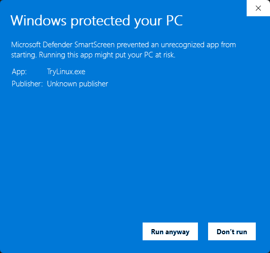

3. Try Linux asks whether to install itself:

   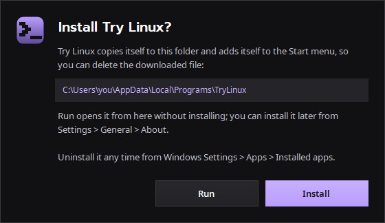

   - **Install** copies Try Linux to `%LOCALAPPDATA%\Programs\TryLinux` and adds it to
     the Start menu, so you can delete the download. **Try Linux is installed**
     confirms it; click **Open** to start the installed copy. No administrator
     permission is needed.
   - **Run** opens it from where it is, without installing. It won't ask again for
     this version; you can install later from **Settings > General > About**.
   - Pressing Esc asks whether to quit, and Try Linux asks again next time.

If a different version is already installed, the same prompt offers **Update**
instead, which replaces the installed copy. Desktop shortcuts and Start with Windows
entries made by another copy move to the installed one.

You can check the download against the SHA-256 hash published with each release:

```powershell
Get-FileHash .\TryLinux.exe -Algorithm SHA256
```

## Uninstall

Use **Windows Settings > Apps > Installed apps > Try Linux > Uninstall**. Quit Try
Linux from its tray icon first. This removes the app, its Start menu entry, desktop
shortcuts and Start with Windows entries. Your systems and downloads are kept in
`%LOCALAPPDATA%\TryLinux`; delete that folder to remove them too.

If you chose **Run** instead of installing, delete `TryLinux.exe` and any desktop
shortcuts you made for it.

## Updates

Once a day, Try Linux checks GitHub for a new release of Try Linux and of
[WINQ-EMU](https://github.com/cmspam/winq-emu), the emulator that runs your systems.
When one is available, a notice at the top of the home screen says so, with an
**Update** button. Try Linux and WINQ-EMU updates each get their own notice.

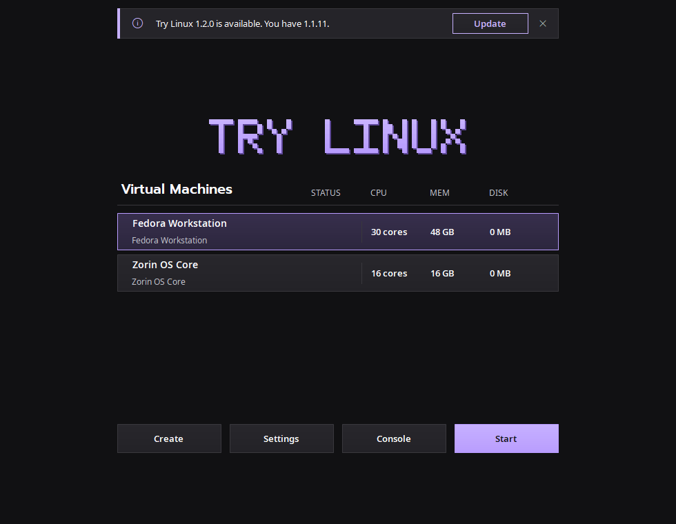

**Try Linux updates**

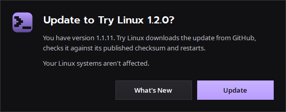

1. **What's New** opens the release notes; **Update** downloads the new `TryLinux.exe`.
2. Try Linux checks the download against the release's published SHA-256 checksum.
   If it doesn't match, the update isn't used.
3. Try Linux replaces itself and restarts. If systems are running, choose **Restart
   Now** or **Update When I Quit**; your systems keep running either way.

Copies that aren't installed update themselves in place. Versions before 1.1.4 don't
have the Update button, so download 1.1.4 once by hand.

**WINQ-EMU updates**

1. **Update WINQ-EMU** shows your version and the new one. WINQ-EMU is an alpha, so
   check **What's New** before updating.
2. Shut down running systems first; WINQ-EMU's files are in use while they run.
3. Try Linux downloads the new installer from the WINQ-EMU releases page and runs it.
   Windows asks for permission, because it installs to `C:\WINQ-EMU`.

**Settings > General > About** shows both versions, has **Check For Updates** to
check right away, and **Check for updates automatically (once a day)** to turn the
daily check off.

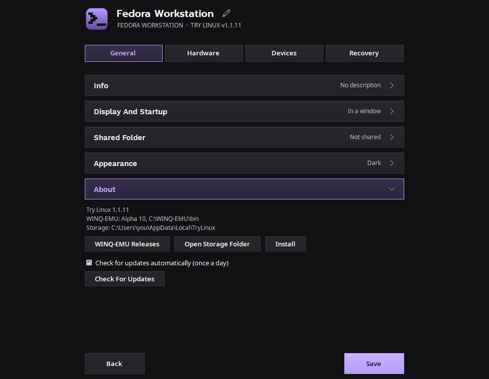

## Using it

Click **Create** and choose a Linux OS (or **Use Your Own Installer**), then:

1. **General:** the system's name, an optional description, and its location (the
   storage folder, or tick **Choose a different location** and browse to another).
2. **Resources:** Balanced, Maximum or Manual memory and CPU cores, and the disk size,
   with the free space on that drive. **Allocate the full size now** takes the disk's
   whole size on the drive straight away instead of as Linux stores data.
3. **Summary:** everything you chose. **Install** downloads and verifies the installer,
   creates the disk and opens the VM window (**Import** copies an existing disk and
   starts it).

Install Linux onto the virtual disk; your Windows drive is never touched.

If Linux runs the QEMU guest agent (`sudo dnf install qemu-guest-agent` on Fedora,
`sudo apt install qemu-guest-agent` on Ubuntu, Debian and Mint), Try Linux shows the
installed OS's own name and version, e.g. *Fedora Linux 45 (Workstation Edition)*.

**Virtual Machines** lists each system with its status (**Running**, **Paused**,
**Off, console open**, or **Ready to install**) and the CPU cores, memory and disk
space it uses.

- **Start** (or double-click) starts the selected system. Try Linux stays open on
  Virtual Machines, behind the system's window.
- **Console** opens a running system's window. On a system that's off, it opens the
  window with the system still off (**Off, console open**); click **Start** to power it
  on there, or close the window. If the system is set to open fullscreen, Console
  asks whether to power it on instead.
- **Closing a system's window** leaves it running, shown as **Running, window
  closed**. Double-click it or click **Console** to bring the window back.
- **Restarting Linux** from inside it starts the system again on its own, in a fresh
  window.
- **Closing Try Linux** leaves your systems running, with Try Linux in the tray.
  Right-click the tray icon to open a system's window, open its shared folder, or use
  its power commands. A system started from a desktop shortcut or at Windows sign-in
  starts with Try Linux in the tray.

**Power** replaces **Start** while a system runs:

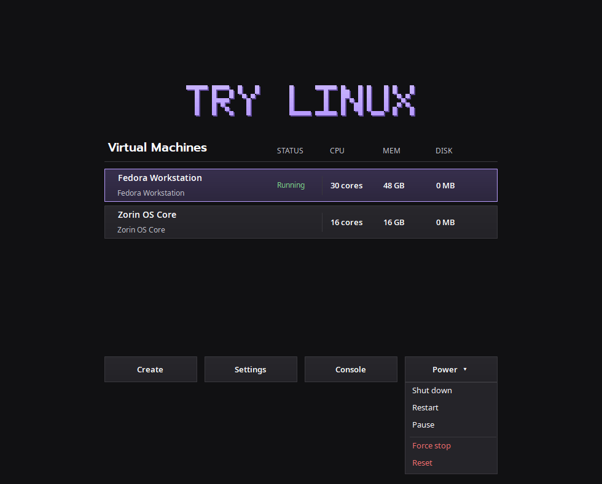

- **Shut down** presses the power button, so Linux shuts down cleanly. Its desktop
  may ask first; GNOME goes ahead on its own after 60 seconds.
- **Restart** shuts down the same way, then starts the system again with any settings
  you changed.
- **Pause** freezes the system where it is; **Resume** continues.
- **Force stop** turns it off immediately, and **Reset** restarts it immediately. Both
  lose unsaved work.

Each command except Pause and Resume asks you to confirm first:

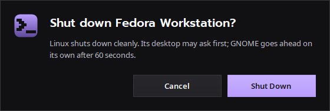 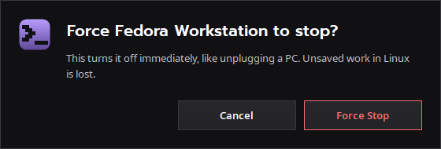

**Several systems can run at once**, each in its own window with its own status and
Power menu. Each one uses the memory its resource profile gives it: two **Balanced**
systems fit, but two **Maximum** ones need more memory than your PC has. New systems
get their own SSH port (2223, 2224, ...), so their port forwards don't clash.

**Settings** (per system). Each tab is a list of sections; click one to open it.
Several can be open at once, and the one you opened last is highlighted. A closed
section shows a summary of its settings; every section starts closed when you open
Settings.
  - **General:** **Info** (the description, the OS and where the system is kept),
    fullscreen and which display, start at Windows sign-in, desktop shortcut, shared
    Windows folder (read-only unless allowed), **Appearance**, and **About** with
    versions, install and update checks.
  - **Appearance** is for Try Linux as a whole: **Dark** (grays with lavender, after
    Firefox's dark theme) or **Light** (white with Proton's purple, after Proton Pass's
    light theme). **Follow system** uses Light while Windows shows apps in light mode,
    and Dark otherwise. The theme changes when you save.
  - **Hardware:**
    - **Graphics:** guest displays, GPU / CPU / automatic rendering, Vulkan, and GPU
      memory up to what your graphics card has.
    - **Resources:** Balanced, Maximum or Manual (memory and CPU cores can be changed
      with Manual). They only go up to what's free: Windows keeps 2 cores and a quarter
      of the memory, and other running systems keep theirs.
    - **Disks:** each disk's current size, free space on its drive, maximum size,
      location and whether it's dynamic or preallocated. Under **Disk Utilities**:
      **Reclaim free space when Linux deletes files** passes Linux's TRIM through, so
      deleted files' space is reused instead of growing the disk file; **Resize** grows
      or shrinks a disk; **Compact** gives a disk's unused space back to Windows;
      **Add Disk** creates a new disk or attaches an existing `.qcow2` file; **Remove**
      takes one out (Linux sees each disk as its own drive and starts from Disk 1).
  - **Devices:** sound and microphone; a **CD/DVD drive** for ISOs such as drivers or
    rescue disks, which you can change while the system runs; **network type** (shared
    with this PC, port forwards only, or no network); and port forwards (`tcp:2223:22`
    for this PC, `lan tcp:8080:80` for your network).
  - **Recovery:** back up, restore as a copy, snapshots, move storage, clean up
    downloads, repair (reset, or boot an ISO), delete.

Size fields (memory, CPU cores, disk size, GPU memory, displays) are dropdowns of
common sizes that you can also type into.

**Reset**, **Delete**, **Clean up downloads**, and reverting or deleting a snapshot ask
first, and pressing Enter picks **Cancel**:

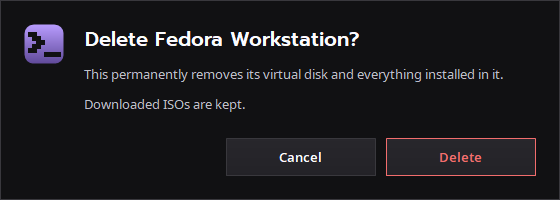 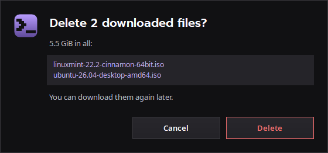

Keyboard: **Ctrl+Alt+G** releases the mouse and keyboard, **Ctrl+Alt+F** toggles
fullscreen.

To use the shared folder in Linux:

```sh
sudo mkdir -p /mnt/host
sudo mount -t 9p -o trans=virtio,version=9p2000.L host /mnt/host
```

Systems, downloads and settings live in `%LOCALAPPDATA%\TryLinux` (or a system's own
location, chosen when you create it; the storage folder is movable from
Settings > Recovery > Storage).

## Troubleshooting

**Check first:** open Task Manager (Ctrl+Shift+Esc), go to **Performance > CPU**, and
look for **Virtualization**. It should say **Enabled**.

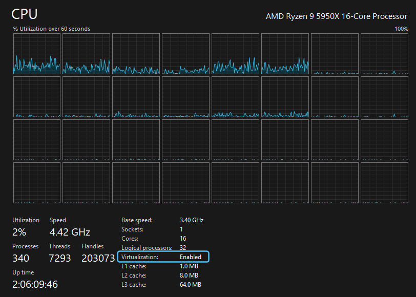

**"Hardware virtualization is turned off in your PC's BIOS/UEFI settings"**
Linux needs the processor's virtualization feature, which some PCs ship with turned off.
Try Linux shows this message:

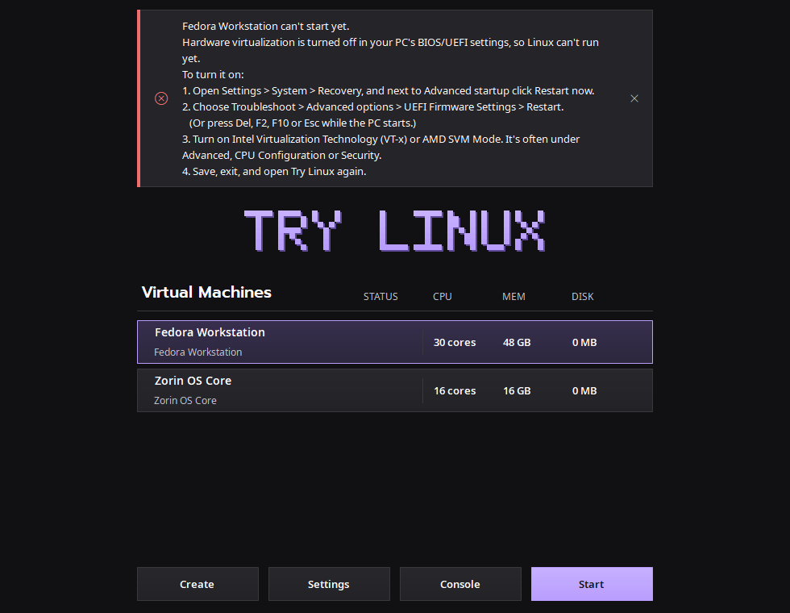

1. Open **Settings > System > Recovery**, and next to **Advanced startup** click **Restart now**.

   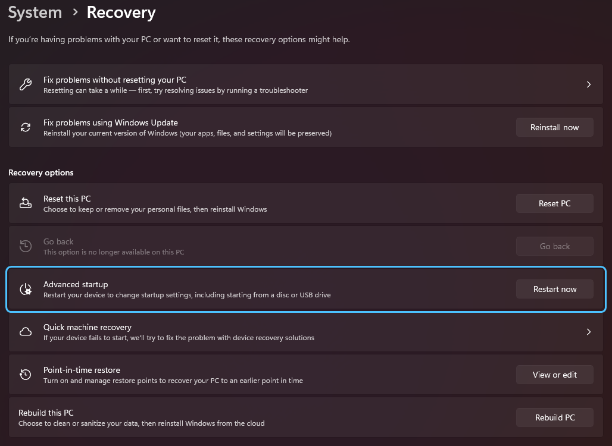

2. Choose **Troubleshoot > Advanced options > UEFI Firmware Settings > Restart**
   (or press Del, F2, F10 or Esc while the PC starts).
3. Turn on **Intel Virtualization Technology (VT-x)** or **AMD SVM Mode**. It's often
   under Advanced, CPU Configuration or Security.
4. Save, exit, and open Try Linux again.

Setup can still download and prepare a system before you change the setting; click
**Install** on the home page afterwards.

**"Turn on Windows Hypervisor Platform?"**
Click **Turn On** and Try Linux turns it on; Windows asks for permission, then needs one
restart.

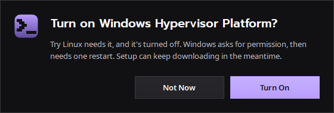

Or do it yourself: press Win+R, type `optionalfeatures`, tick **Windows Hypervisor
Platform**, click **OK**, then restart.

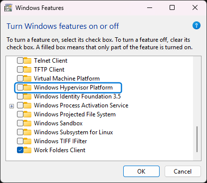

If **Hyper-V** is already on, Try Linux may work without this box ticked; it only asks
when it can't start a VM.

**"Windows Hypervisor Platform is turned on but isn't running yet"**
Restart Windows. If the message comes back after restarting, virtualization is
probably off in the BIOS/UEFI; follow the steps above.

**"This PC's processor doesn't support hardware virtualization"**
Try Linux can't run on this PC.

## Limitations

- No camera or USB passthrough, and no choice of sound device (Windows defaults
  are used). WINQ-EMU doesn't support these.
- No clipboard sharing or drag-and-drop between Windows and Linux: WINQ-EMU's QEMU
  is built without SPICE, which QEMU's clipboard channel needs. Use the shared folder,
  or SSH (`ssh -p 2223 you@localhost`) to paste into a terminal.
- Chromium-based browsers can show black video in the guest; Firefox works best.
- WINQ-EMU is alpha software.

## Building from source

Try Linux uses the C# compiler that ships with Windows, so nothing needs installing:

```bat
build.cmd
```

This produces `TryLinux.exe` from `TryLinux.cs` and `Settings.cs`, with the fonts in `fonts/` embedded.

`try-linux-vm.ps1` is a standalone PowerShell script that does the same VM setup
from the command line.

## Credits

- [WINQ-EMU](https://github.com/cmspam/winq-emu) by cmspam: QEMU (GPL-2.0),
  virglrenderer (MIT), launcher (MIT). Downloaded by Try Linux, not redistributed.
- Inspired by [Try Omarchy for Windows](https://github.com/omacom/try-omarchy-windows).
- Linux distributions are downloaded from their official mirrors and carry their own licenses.
- Fonts, embedded in the app under the [SIL Open Font License 1.1](fonts/):
  [Prompt](https://github.com/cadsondemak/Prompt) by Cadson Demak,
  [Work Sans](https://github.com/weiweihuanghuang/Work-Sans) by Wei Huang and
  [Noto Sans](https://github.com/notofonts/latin-greek-cyrillic) by the Noto Project Authors.

## License

Try Linux is released under the [MIT License](LICENSE).
